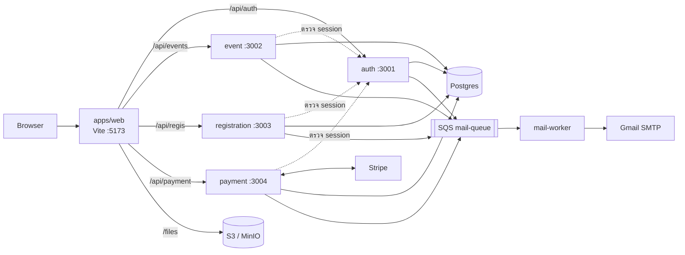

# Eventide

เว็บไซต์ขายและจัดการตั๋วอีเวนต์ สร้างเป็น monorepo ของ microservices บน [Bun](https://bun.com)

- **หน้าเว็บ** เป็น React SPA ที่เรียก service ผ่าน Eden Treaty จึงได้ type จาก backend ถึง frontend โดยไม่ต้องเขียน API client เอง
- **แต่ละโดเมนเป็น service ของตัวเอง** (auth, event, registration, payment) แยก process และ port แต่ใช้ Postgres ก้อนเดียวกัน
- **งานที่ไม่ต้องรอ** อย่างการส่งอีเมล ส่งผ่านคิว SQS ให้ worker ทำ ไฟล์เก็บใน S3

## ความสามารถ

| บทบาท | ทำอะไรได้ |
|---|---|
| ผู้ใช้ (`user`) | ค้นหาอีเวนต์ตามคำค้น หมวดหมู่ หรือผู้จัดงาน, ลงทะเบียนและชำระเงิน, ดูตั๋วพร้อม QR code, แก้โปรไฟล์, สมัครเป็นผู้จัดงาน |
| ผู้จัดงาน (`organizer`) | สร้างอีเวนต์ (ปก, แกลเลอรี, รายละเอียดแบบ rich text, ตั้งเวลาเผยแพร่), สร้างประเภทตั๋วและแบบฟอร์มลงทะเบียน, เชิญผู้เข้าร่วมทางอีเมล, อนุมัติหรือปฏิเสธการลงทะเบียน, ดูรายชื่อผู้เข้าร่วม ทำได้เฉพาะอีเวนต์ของตัวเอง |
| ผู้ดูแลระบบ (`admin`) | จัดการทุกอีเวนต์และหมวดหมู่, ระงับอีเวนต์หรือบัญชี, จัดการบัญชีผู้ใช้, อนุมัติใบสมัครผู้จัดงาน |

**ประเภทตั๋ว** มีสามแบบ:

- `first_come`: มาก่อนได้ก่อนตามโควตา
- `approval`: ผู้จัดอนุมัติทีละคน
- `invite`: เฉพาะอีเมลที่ได้รับเชิญ

ตั๋วฟรีหรือมีราคาก็ได้ ตั๋วที่มีราคาจ่ายผ่าน Stripe Checkout ถ้าเงินเข้าหลังที่นั่งหมด ระบบจะคืนเงินให้เอง

**ยังไม่เสร็จ:** เช็คอินผู้เข้าร่วม และหน้าคำขอคืนเงินใน dashboard

## สถาปัตยกรรม



- **Routing:** ตอน dev, Vite proxy แต่ละ path prefix ไปยัง port ของ service นั้น
- **Session:** service อื่นตรวจ session โดยส่ง cookie ไปถาม `apps/auth` แล้ว cache คำตอบใน Redis 60 วินาที รายละเอียดอยู่ใน [docs/auth.md](docs/auth.md)

| Workspace | Port | Prefix | หน้าที่ |
|---|---|---|---|
| `apps/web` | 5173 | | React SPA |
| `apps/auth` | 3001 | `/api/auth` | Better Auth: บัญชี, session, บทบาท, การระงับ, ใบสมัครผู้จัดงาน |
| `apps/event` | 3002 | `/api/events` | อีเวนต์, หมวดหมู่, รูปภาพ, คำเชิญ, ประเภทตั๋วและแบบฟอร์ม |
| `apps/registration` | 3003 | `/api/regis` | ที่นั่งว่าง, การลงทะเบียน (อนุมัติ / ปฏิเสธ), ตั๋วของฉัน |
| `apps/payment` | 3004 | `/api/payment` | Stripe Checkout, webhook, การคืนเงิน |
| `apps/mail-worker` | | | อ่านคิว `mail-queue` แล้วส่งอีเมลผ่าน Gmail |

| Package | หน้าที่ |
|---|---|
| `@app/db` | Drizzle schema, migration และ client ที่ทุก service ใช้ร่วมกัน |
| `@app/auth-guard` | บทบาทและสิทธิ์ (ใช้ใน web ด้วย), plugin `authGuard` ของ Elysia |
| `@app/mail` | สัญญาของคิวอีเมล: `enqueueMail()` และ `parseMailMessage()` |
| `@app/storage` | อัปโหลดไฟล์ลง S3 พร้อมตรวจชนิดและขนาดไฟล์ |
| `@app/tickets` | ออกตั๋วร่วมกันระหว่าง registration และ payment |

**Stack:**

| ส่วน | เทคโนโลยี |
|---|---|
| Frontend | React 19, Vite, TanStack Router / Query / Form / Table, shadcn/ui บน Base UI, Tailwind CSS 4 |
| Backend | ElysiaJS 2, Better Auth |
| ข้อมูล | Drizzle ORM บน Postgres 18, Redis 8 |
| ไฟล์และคิว | S3 (MinIO ตอน dev), SQS (ElasticMQ ตอน dev) |
| ภายนอก | Stripe, Gmail SMTP ผ่าน Nodemailer |

## เริ่มต้นใช้งาน

ต้องมี [Bun](https://bun.com) 1.4 ขึ้นไป และ Docker (พร้อม Compose)

```sh
bun install
cp .env.example .env        # ทุก workspace อ่าน .env ที่ root
```

เปิด `.env` แล้วใส่ `BETTER_AUTH_SECRET` (สร้างด้วย `openssl rand -base64 32`) ค่าอื่นใช้ค่าเริ่มต้นได้เลย

```sh
bun run infra:up            # Postgres, Redis, ElasticMQ, MinIO
bun run db:migrate
bun run dev                 # web + ทุก service + mail worker
```

1. เปิด http://localhost:5173 แล้วสมัครสมาชิก
2. ตั้งบัญชีแรกเป็นผู้ดูแลระบบ แล้ว reload หน้าเว็บ:

   ```sh
   cd apps/auth && bun run admin:promote you@example.com
   ```

3. สร้างหมวดหมู่ที่ `/dashboard/categories` ก่อน เพราะอีเวนต์ทุกอันต้องมีหมวดหมู่

หน้า `/status` แสดงสถานะของทุก service

### ตัวเลือกเสริม

ส่วนนี้ไม่ต้องตั้งก็รันได้

| ฟีเจอร์ | ตั้งค่า | ถ้าไม่ตั้ง |
|---|---|---|
| เข้าสู่ระบบด้วย Google | `GOOGLE_CLIENT_ID`, `GOOGLE_CLIENT_SECRET` (redirect URI: `http://localhost:5173/api/auth/callback/google`) | มีแค่อีเมลและรหัสผ่าน |
| ชำระเงิน | `STRIPE_SECRET_KEY` (sandbox key) และ `STRIPE_WEBHOOK_SECRET` จาก `bun run stripe:listen` ดูขั้นตอนใน [docs/stripe.md](docs/stripe.md) | ตั๋วฟรีใช้ได้ แต่ตั๋วที่มีราคาจ่ายเงินไม่ได้ |
| ส่งอีเมลจริง | `GMAIL_USER`, `GMAIL_APP_PASSWORD` ([App Password](https://myaccount.google.com/apppasswords)) | mail worker พิมพ์อีเมลลง log แทนการส่ง |

### บริการในเครื่อง

| บริการ | ที่อยู่ | หมายเหตุ |
|---|---|---|
| Postgres 18 | `localhost:5432` | `bun run db:studio` เปิด Drizzle Studio |
| Redis 8 | `localhost:6379` | |
| ElasticMQ (SQS) | API `:9324`, UI http://localhost:9325 | คิว `mail-queue` และ `mail-dlq` |
| MinIO (S3) | API `:9000`, console http://localhost:9001 | login `minioadmin` / `minioadmin`, bucket `event-assets` |

`bun run infra:down` หยุดบริการ และ `bun run infra:reset` ล้างข้อมูลทั้งหมดแล้วเริ่มใหม่

## คำสั่งที่ใช้บ่อย

```sh
bun run dev                         # ทุก app พร้อมกัน
bun run --filter @app/event dev     # app เดียว

bun run db:generate                 # สร้าง migration จาก schema ที่แก้ (packages/db/drizzle/)
bun run db:migrate                  # รัน migration

bun run --filter @app/web lint      # oxlint
bun run --filter @app/web build     # tsc -b && vite build
```

**Type check:** รัน `bun check` จาก**ใน** workspace เช่น `cd apps/web && bun check` อย่ารันที่ root เพราะ tsconfig ที่ root ไม่มี DOM lib และ alias `@/*` จึงรายงาน error ที่ไม่มีจริงใน `apps/web`

## การทดสอบ

ใช้ `bun test` ชุดทดสอบที่ต้องใช้ฐานข้อมูลหรือ Redis ต้อง `bun run infra:up` ก่อน แล้วรันจากใน workspace:

```sh
cd apps/event && bun run test       # หรือ apps/auth, apps/registration, apps/payment,
                                    # packages/auth-guard, packages/storage
bun test test/event.test.ts         # ไฟล์เดียว
bun test -t "pattern"               # เฉพาะเทสต์ที่ชื่อตรง
```

## โครงสร้างโปรเจกต์

```
apps/
  web/            React SPA (TanStack Router แบบ file-based ใน src/routes/)
  auth/           Better Auth
  event/          อีเวนต์ หมวดหมู่ คำเชิญ ประเภทตั๋ว
  registration/   การลงทะเบียนและตั๋ว
  payment/        Stripe
  mail-worker/    ส่งอีเมลจากคิว
packages/
  db/  auth-guard/  mail/  storage/  tickets/
infra/            ค่าตั้งคิวของ ElasticMQ สำหรับ docker-compose
docs/             เอกสารออกแบบ
```

แต่ละ service จัดโค้ดเป็น `src/routes/<feature>/{index,model,service}.ts`: controller, schema ของ request/response และ business logic

## เอกสาร

- [docs/auth.md](docs/auth.md): การยืนยันตัวตน บทบาท และการตรวจสิทธิ์ข้าม service
- [docs/tickets.md](docs/tickets.md): ประเภทตั๋ว วงจรการลงทะเบียน การล็อกที่นั่ง และการชำระเงิน
- [docs/stripe.md](docs/stripe.md): ตั้งค่า Stripe ตั้งแต่ sandbox จนถึง webhook บน production
- [docs/storage.md](docs/storage.md): การอัปโหลดและเก็บไฟล์
- [CLAUDE.md](CLAUDE.md): ข้อตกลงในการเขียนโค้ดของโปรเจกต์ทั้งหมด
