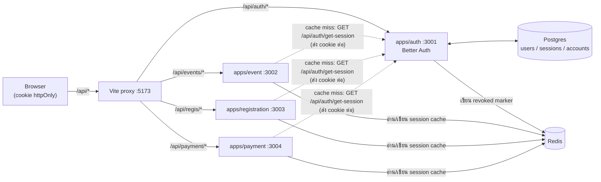
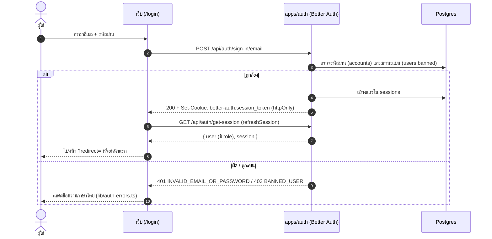
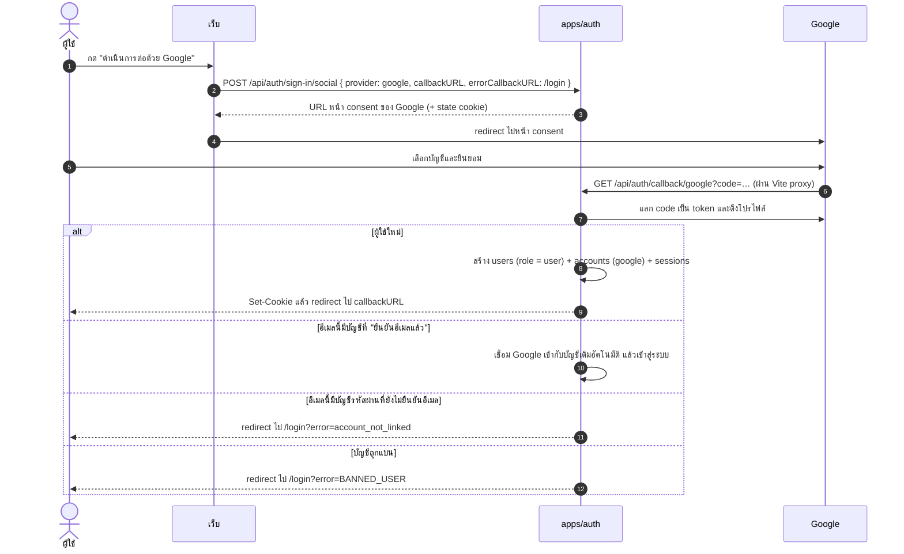
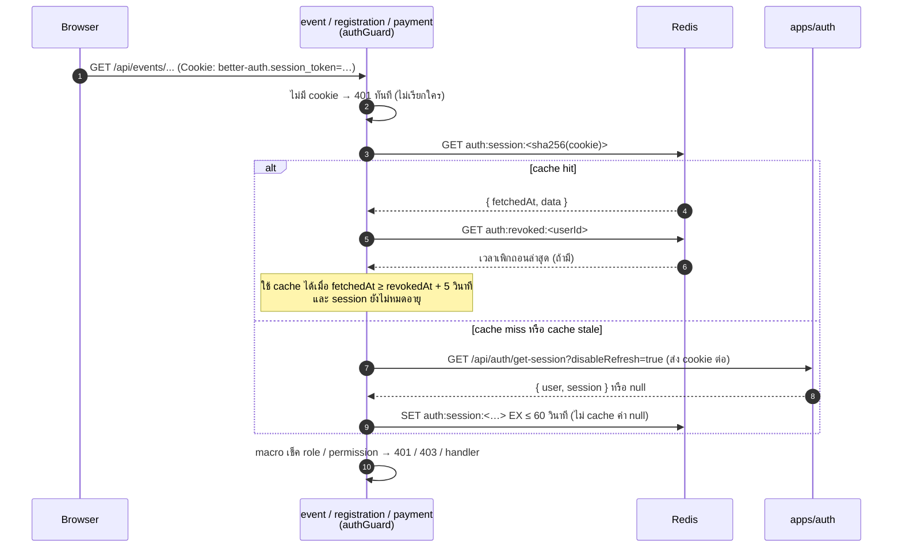
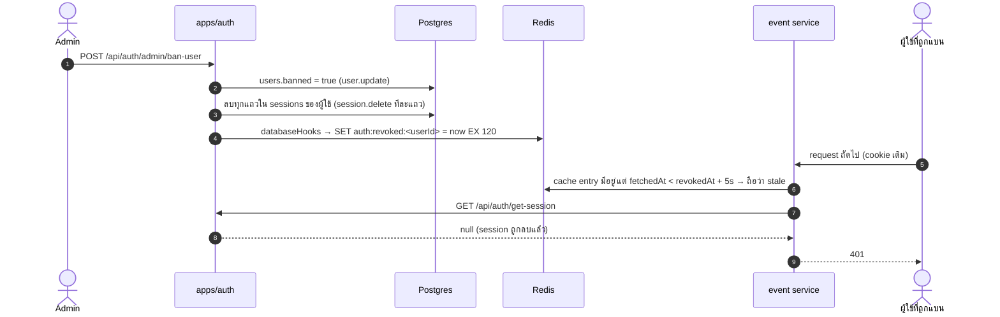
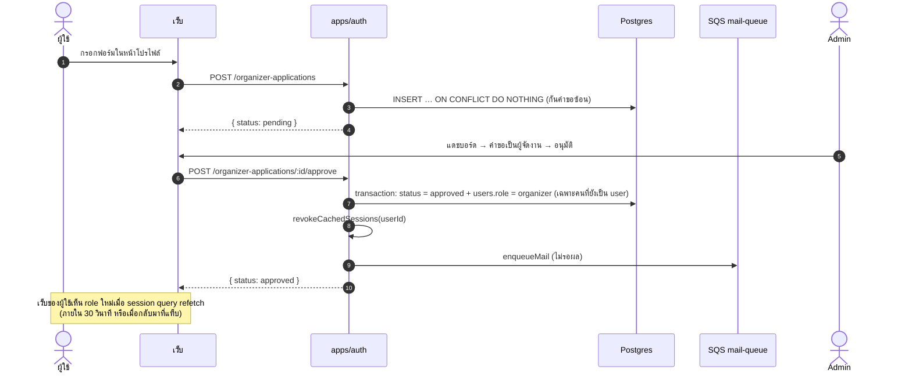
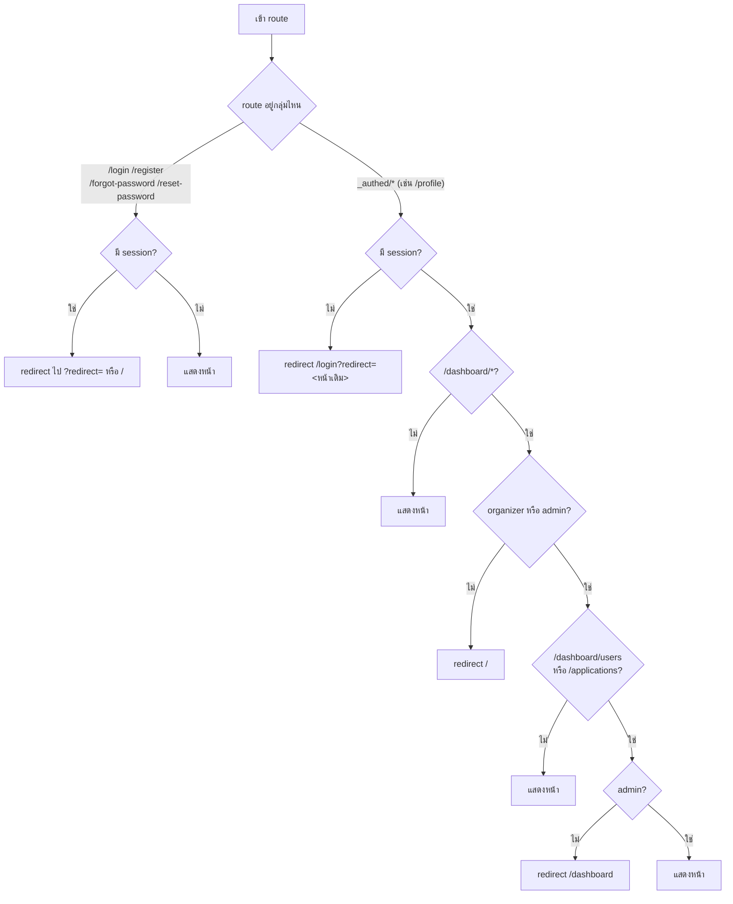

# ระบบยืนยันตัวตนและสิทธิ์ (Auth)

เอกสารนี้อธิบายว่า Eventide รู้ได้อย่างไรว่าใครกำลังใช้งาน มีบทบาทอะไร และแต่ละ service ตรวจสิทธิ์อย่างไร

- **Authentication** (คนนี้คือใคร) อยู่ที่เดียว: `apps/auth` ซึ่งรัน [Better Auth](https://better-auth.com)
- **Authorization** (คนนี้ทำสิ่งนี้ได้ไหม) อยู่ในแต่ละ service ผ่าน macro ของ `@app/auth-guard`
- browser ถือแค่ cookie แบบ httpOnly ไม่มี JWT ให้ JavaScript อ่านได้

## สารบัญ

1. [ภาพรวม](#1-ภาพรวม)
2. [บทบาทและสิทธิ์](#2-บทบาทและสิทธิ์)
3. [การเข้าสู่ระบบ](#3-การเข้าสู่ระบบ)
4. [service อื่นรู้ได้อย่างไรว่าใครเรียก](#4-service-อื่นรู้ได้อย่างไรว่าใครเรียก)
5. [การเพิกถอนสิทธิ์ทันที](#5-การเพิกถอนสิทธิ์ทันที)
6. [สมัครเป็นผู้จัดงาน](#6-สมัครเป็นผู้จัดงาน)
7. [Route guard ฝั่งเว็บ](#7-route-guard-ฝั่งเว็บ)
8. [เมื่อมีส่วนใดล่ม](#8-เมื่อมีส่วนใดล่ม)
9. [ทำไมออกแบบแบบนี้](#9-ทำไมออกแบบแบบนี้)
10. [ใช้ guard ใน service ใหม่](#10-ใช้-guard-ใน-service-ใหม่)
11. [การตั้งค่า](#11-การตั้งค่า)
12. [ไฟล์ที่เกี่ยวข้อง](#12-ไฟล์ที่เกี่ยวข้อง)

---

## 1. ภาพรวม



- มีแค่ `apps/auth` ที่อ่านและเขียนตาราง auth (`users`, `sessions`, `accounts`, `verifications`) และถือ `BETTER_AUTH_SECRET`
- service อื่นไม่แตะตาราง auth ถ้าอยากรู้ว่า cookie นี้เป็นของใคร จะถาม auth service แล้ว cache คำตอบไว้ใน Redis ([ข้อ 4](#4-service-อื่นรู้ได้อย่างไรว่าใครเรียก))
- ทุก request วิ่งผ่าน origin เดียวกัน (Vite proxy ตอน dev) cookie จึงถูกส่งไปทุก service โดยไม่ต้องตั้ง CORS

## 2. บทบาทและสิทธิ์

บทบาทเก็บในคอลัมน์ `users.role` ผ่าน admin plugin ของ Better Auth กำหนดไว้ที่ [`packages/auth-guard/src/permissions.ts`](../packages/auth-guard/src/permissions.ts) ซึ่งใช้ร่วมกันทั้ง auth service, service อื่น และเว็บ

| บทบาท | ได้มาอย่างไร | ทำอะไรได้ |
|---|---|---|
| `user` (ผู้ใช้) | ค่าเริ่มต้นตอนสมัคร | จองตั๋ว ดูตั๋วของตัวเอง จัดการโปรไฟล์ สมัครเป็นผู้จัดงาน |
| `organizer` (ผู้จัดงาน) | admin อนุมัติคำขอ หรือเปลี่ยนบทบาทให้ | สร้างอีเวนต์ ประเภทตั๋ว ฟอร์มลงทะเบียน เช็คอิน ดูแดชบอร์ด **เฉพาะอีเวนต์ของตัวเอง** |
| `admin` (ผู้ดูแลระบบ) | `admin:promote` หรือ admin คนอื่นตั้งให้ | ทุกอย่าง: จัดการทุกอีเวนต์ ระงับบัญชี เปลี่ยนบทบาท อนุมัติคำขอ |

permission statement ที่ใช้กับ macro `permission`:

| statement | user | organizer | admin |
|---|---|---|---|
| `user: [create, list, set-role, ban, …]` | – | – | ✅ |
| `event: [create, update, delete]` | – | ✅ | ✅ |
| `event: [manage-all]` | – | – | ✅ |
| `ticket: [check-in]` | – | ✅ | ✅ |
| `organizer-application: [apply]` | ✅ | – | – |
| `organizer-application: [review]` | – | – | ✅ |

> statement บอกแค่ว่า "บทบาทนี้ทำสิ่งนี้ได้" ส่วนความเป็นเจ้าของ (organizer แก้ได้เฉพาะอีเวนต์ของตัวเอง) ต้องเช็คใน service เพราะต้องรู้ข้อมูลอีเวนต์

## 3. การเข้าสู่ระบบ

### อีเมลและรหัสผ่าน



### Google (OAuth)

ปุ่ม "ดำเนินการต่อด้วย Google" แสดงเฉพาะเมื่อ `GET /api/auth/providers` ตอบ `{ google: true }` ซึ่งเป็นจริงเมื่อตั้งทั้ง `GOOGLE_CLIENT_ID` และ `GOOGLE_CLIENT_SECRET`



**กฎการเชื่อมบัญชี (account linking):**
- Better Auth จะรวม Google เข้ากับบัญชีเดิมโดยอัตโนมัติก็ต่อเมื่ออีเมลของบัญชีเดิม **ยืนยันแล้ว** (ค่าเริ่มต้น `requireLocalEmailVerified: true`)
- ตอนนี้ยังไม่มีระบบยืนยันอีเมล บัญชีที่สมัครด้วยรหัสผ่านจึงถูกปฏิเสธด้วย `account_not_linked`
- กฎนี้กันการยึดบัญชี: ถ้าไม่มีกฎนี้ คนร้ายจะสมัครด้วยอีเมลของเหยื่อไว้ก่อน แล้วรอให้เหยื่อเข้าด้วย Google เพื่อยึดบัญชีได้
- วิธีเชื่อมที่ถูกต้อง: เข้าสู่ระบบด้วยรหัสผ่าน แล้วกด **"เชื่อมต่อ Google"** ในหน้าโปรไฟล์ (`linkSocial`)
- ยกเลิกการเชื่อมต่อได้เมื่อยังมีช่องทางเข้าสู่ระบบอื่นเหลืออยู่ Better Auth ไม่ยอมให้ลบช่องทางสุดท้าย

### ลืมรหัสผ่าน

1. `/forgot-password` เรียก `requestPasswordReset({ email, redirectTo: <origin>/reset-password })`
2. auth service สร้าง token แล้ว `enqueueMail()` ลง SQS เพื่อให้ mail worker ส่งอีเมล ระบบตอบเหมือนกันทุกครั้งไม่ว่าอีเมลจะมีอยู่หรือไม่ จึงใช้เดาว่าอีเมลไหนมีบัญชีไม่ได้
3. ลิงก์ในอีเมลไปที่ `/api/auth/reset-password/<token>` ซึ่งจะ redirect ต่อไป `/reset-password?token=…`
4. `/reset-password` เรียก `resetPassword({ newPassword, token })`

## 4. service อื่นรู้ได้อย่างไรว่าใครเรียก

ใช้แพทเทิร์น **token introspection + cache**: service ส่ง cookie ไปถาม auth service แล้ว cache คำตอบไว้ใน Redis



| Redis key | ค่า | TTL | ใครเขียน |
|---|---|---|---|
| `auth:session:<sha256(cookie)>` | `{ fetchedAt, data: AuthSession }` | ≤ 60 วินาที (และไม่เกินเวลาหมดอายุของ session) | service ที่ใช้ `authGuard` |
| `auth:revoked:<userId>` | เวลาที่ถูกเพิกถอน (ms) | 120 วินาที (นานกว่า cache เสมอ) | `apps/auth` (`databaseHooks`) และ `admin:promote` |

รายละเอียดที่ควรรู้:
- **key ใช้ hash ของ cookie** ไม่ใช่ตัว token จริง แม้ Redis หลุด ก็เอา key ไปใช้เป็น cookie ไม่ได้
- **`AuthSession` เป็นข้อมูลแบบแคบ** มีแค่ `{ user: { id, name, email, image, role }, session: { id, expiresAt } }` ไม่ส่งข้อมูลอื่นของ Better Auth ไปทุก service
- **`disableRefresh=true`** ทำให้ service แค่อ่าน session ไม่ยืดอายุ การยืดอายุเกิดตอนเว็บเรียก `get-session` เอง
- **วัดจริงบนเครื่อง dev:** cache miss ใช้ประมาณ 13 ms และ cache hit ประมาณ 0.5 ms
- **`apps/auth` ใช้ macro ชุดเดียวกัน** แต่ resolver อ่าน DB ตรง (`auth.api.getSession`) แทนการเรียก HTTP หาตัวเอง (`apps/auth/src/plugins/auth.ts`)

## 5. การเพิกถอนสิทธิ์ทันที

ปัญหาของ cache คือข้อมูลอาจเก่า ระบบแก้ด้วยการให้ auth service เขียน "revoked marker" ทุกครั้งที่มีอะไรเปลี่ยน



เหตุการณ์ที่ทำให้ cache ของผู้ใช้ stale (ทั้งหมดอยู่ใน `databaseHooks` ของ `apps/auth/src/libs/auth.ts`):

| เหตุการณ์ | hook |
|---|---|
| แบน / ยกเลิกแบน / เปลี่ยน role / แก้โปรไฟล์ | `user.update.after` |
| ลบผู้ใช้ | `user.delete.after` |
| ออกจากระบบ / ยกเลิก session / ลบ session ทั้งหมดตอนแบน | `session.delete.after` (Better Auth เรียกทีละแถวแม้เป็นการลบหลายแถว) |
| อนุมัติคำขอเป็นผู้จัดงาน | เรียก `revokeCachedSessions()` เองหลังอัปเดต role ใน transaction |
| `admin:promote` | เรียก `markUserRevoked()` เอง |

**ทำไมต้องมีระยะ 5 วินาที:** request ที่เริ่มถามข้อมูลก่อนการเพิกถอนแต่ตอบกลับมาทีหลัง อาจเขียน cache เก่าทับลงไป และนาฬิกาของแต่ละเครื่องอาจคลาดกันเล็กน้อย การถือว่า entry ที่ได้มาภายใน 5 วินาทีหลังการเพิกถอนเป็นของเก่าแก้ได้ทั้งสองกรณี ผลเสียมีแค่ cache miss เพิ่มขึ้นในช่วง 5 วินาทีนั้น

## 6. สมัครเป็นผู้จัดงาน

ตาราง `organizer_applications` (เจ้าของคือ `apps/auth`) มี partial unique index ที่ทำให้แต่ละผู้ใช้มีคำขอสถานะ `pending` ได้แค่หนึ่งคำขอ

| Endpoint (`/api/auth/organizer-applications`) | ใครเรียกได้ | ทำอะไร |
|---|---|---|
| `GET /me` | ผู้ที่เข้าสู่ระบบ | คำขอล่าสุดของตัวเอง → `{ application: … \| null }` |
| `POST /` | `user` เท่านั้น | ยื่นคำขอ ถ้ามีคำขอที่รอพิจารณาอยู่จะได้ 409 `APPLICATION_PENDING` |
| `GET /?status=` | `admin` | รายการคำขอพร้อมข้อมูลผู้สมัคร |
| `POST /:id/approve` | `admin` | อนุมัติ: เปลี่ยน role เป็น `organizer` และส่งอีเมล |
| `POST /:id/reject` | `admin` | ปฏิเสธพร้อมหมายเหตุ (ไม่บังคับ) และส่งอีเมล |



## 7. Route guard ฝั่งเว็บ

ทุก guard อ่าน session ผ่าน TanStack Query (`sessionQueryOptions` ใน `apps/web/src/lib/session.ts`) ใน `beforeLoad` จึงไม่ยิงซ้ำถ้ามีข้อมูลใน cache แล้ว



- `?redirect=` รับเฉพาะ path ภายในเว็บ (`safeRedirect`) เพื่อกัน open redirect เช่น `//evil.com`
- guard ฝั่งเว็บช่วยเรื่องประสบการณ์ใช้งานเท่านั้น **การป้องกันจริงอยู่ที่ API** ทุก endpoint เช็คสิทธิ์ซ้ำด้วย macro

## 8. เมื่อมีส่วนใดล่ม

| สถานการณ์ | ผลที่เกิด |
|---|---|
| Redis ล่ม | `authGuard` ข้าม cache ไปถาม auth service ทุกครั้ง ช้าลงแต่ผลยังถูกต้อง |
| Redis ล่มตอนมีการเพิกถอน | hook เขียน marker ไม่ได้ (log error แต่ไม่ขัดการแบน) cache เดิมที่ไม่ stale อาจใช้ต่อได้ **สูงสุด 60 วินาที** นี่คือข้อจำกัดที่รู้อยู่ |
| auth service ล่ม | ผู้ใช้ที่มี cache อยู่ยังใช้งานได้จน cache หมดอายุ (≤ 60 วินาที) นอกนั้นได้ 503 `AUTH_UNAVAILABLE` |
| Postgres ล่ม | เข้าสู่ระบบไม่ได้ service ได้ 503 เมื่อ cache miss |
| SQS / mail worker ล่ม | การอนุมัติหรือปฏิเสธยังสำเร็จ อีเมลค้างอยู่ใน queue และถูกส่งเมื่อ worker กลับมา |

## 9. ทำไมออกแบบแบบนี้

ทางเลือกที่พิจารณา:

| | ใครตอบว่า cookie นี้คือใคร | service ต้องถือ | เพิกถอน | ฝั่งเว็บ |
|---|---|---|---|---|
| A. แชร์ instance ของ Better Auth ให้ทุก service | service query DB ของ auth เอง | secret + สิทธิ์อ่านตาราง auth | ทันที | ไม่เปลี่ยน |
| **B. Introspection + Redis cache (ที่เลือก)** | auth service (cache 60 วินาที) | Redis เท่านั้น | ทันที (revoked marker) | ไม่เปลี่ยน |
| C. JWT + JWKS (+ Redis denylist) | service verify JWT เอง | public key + Redis | ทันทีถ้ามี denylist | ต้องเก็บและ refresh token ใน JS |
| D. API Gateway + internal JWT | gateway ทำครั้งเดียว | public key | ทันที | ไม่เปลี่ยน |

เหตุผลที่เลือก B:
- **ตรงหลัก database per service:** มีแค่ `apps/auth` ที่แตะตาราง auth และถือ secret แบบ A ทำให้ทุก service ต้องอ่านตาราง auth เอง
- **ไม่มี JWT ใน browser:** cookie เป็น httpOnly JavaScript จึงอ่าน token ไม่ได้ แบบ C ต้องเก็บ JWT ใน JS ซึ่งเสี่ยงโดนขโมยผ่าน XSS
- **เพิกถอนได้ทันที:** admin ต้องระงับบัญชีได้ทันที แบบ C ที่ไม่มี denylist จะช้าสุดเท่าอายุของ token
- **เขียนโค้ดน้อยและฝั่งเว็บไม่ต้องจัดการ token**

**ทางต่อยอดไปแบบ D:** ย้าย logic ใน `getSession()` ไปไว้ใน gateway (เช่น `apps/gateway`, Traefik ForwardAuth หรือ Nginx `auth_request`) ให้ gateway แนบ internal JWT ไปให้ service แล้วเปลี่ยน resolver ของ `createAuthGuard` เป็นการ verify JWT โค้ดฝั่ง route (`{ auth: true }`, `{ role: [...] }`) ไม่ต้องแก้

## 10. ใช้ guard ใน service ใหม่

```ts
import { Elysia } from "elysia";
import { authGuard } from "@app/auth-guard";

export const event = new Elysia({ prefix: "/api/events" })
  .use(authGuard)
  // ต้องเข้าสู่ระบบ
  .get("/my-tickets", { auth: true }, ({ user }) => listTickets(user.id))
  // ต้องเป็นบทบาทใดบทบาทหนึ่ง
  .get("/dashboard", { role: ["organizer", "admin"] }, ({ user }) => dashboardFor(user))
  // ต้องมี permission statement
  .post("/", { permission: { event: ["create"] } }, ({ user, body }) => createEvent(user.id, body));
```

- `user` มี type `AuthUser = { id, name, email, image, role }`
- ไม่มี session ได้ 401 `UNAUTHORIZED` ผิดบทบาทได้ 403 `FORBIDDEN` และ auth service ล่มได้ 503 `AUTH_UNAVAILABLE` (problem document ที่มี `detail` ภาษาไทย)
- **ความเป็นเจ้าของ** (เช่น organizer แก้ได้เฉพาะอีเวนต์ของตัวเอง) ให้เช็คใน plugin หรือ macro ของ service นั้น ใช้ `user.id` และข้อมูลอีเวนต์ ไม่ต้องเขียนกระจายใน handler

## 11. การตั้งค่า

ตัวแปรใน `.env` ที่ root (ดู `.env.example`):

| ตัวแปร | ใช้ทำอะไร |
|---|---|
| `BETTER_AUTH_URL` | origin ที่ browser ใช้ (`http://localhost:5173` ตอน dev) ไม่ใช่พอร์ต 3001 |
| `BETTER_AUTH_SECRET` | ใช้เซ็น cookie มีแค่ `apps/auth` ที่ใช้ สร้างด้วย `openssl rand -base64 32` |
| `AUTH_SERVICE_URL` | URL ภายในที่ service อื่นใช้ถาม session (ค่าเริ่มต้น `http://localhost:3001`) |
| `REDIS_URL` | session cache และ revoked marker |
| `GOOGLE_CLIENT_ID` / `GOOGLE_CLIENT_SECRET` | เปิด Google login (ต้องตั้งครบทั้งสองตัว) |

**สร้าง admin คนแรก:** สมัครผ่านเว็บก่อน แล้วรัน

```sh
cd apps/auth && bun run admin:promote you@example.com
```

**ตั้งค่า Google** ใน [Google Cloud Console](https://console.cloud.google.com/apis/credentials) → OAuth client ID ชนิด *Web application*:
- Authorized JavaScript origins: `http://localhost:5173`
- Authorized redirect URIs: `http://localhost:5173/api/auth/callback/google`

ตอน deploy ให้เปลี่ยนเป็น origin จริงให้ตรงกับ `BETTER_AUTH_URL`

## 12. ไฟล์ที่เกี่ยวข้อง

| ไฟล์ | หน้าที่ |
|---|---|
| `apps/auth/src/libs/auth.ts` | config ของ Better Auth: provider, admin plugin, `databaseHooks` สำหรับเพิกถอน |
| `apps/auth/src/app.ts` | รวม route: `/health`, `/providers`, organizer applications และส่งที่เหลือให้ Better Auth |
| `apps/auth/src/plugins/auth.ts` | guard ของ auth service ที่อ่าน DB ตรง |
| `apps/auth/src/routes/organizer-applications/` | controller, model และ service ของคำขอเป็นผู้จัดงาน |
| `apps/auth/scripts/promote-admin.ts` | สคริปต์สร้าง admin คนแรก |
| `packages/auth-guard/src/permissions.ts` | บทบาทและ permission (ใช้ได้ใน browser) |
| `packages/auth-guard/src/session.ts` | introspection, Redis cache และ `markUserRevoked` |
| `packages/auth-guard/src/plugin.ts` | `createAuthGuard` / `authGuard` (macro `auth`, `role`, `permission`) |
| `packages/db/src/schema/organizer.ts` | ตาราง `organizer_applications` |
| `apps/web/src/lib/auth-client.ts` | client ของ Better Auth ฝั่งเว็บ (`auth`) |
| `apps/web/src/lib/session.ts` | session query, guard helper และ sign-out |
| `apps/web/src/routes/_authed.tsx` | guard ของทุกหน้าที่ต้องเข้าสู่ระบบ |
