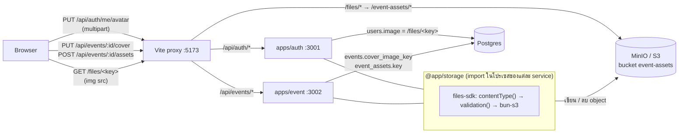
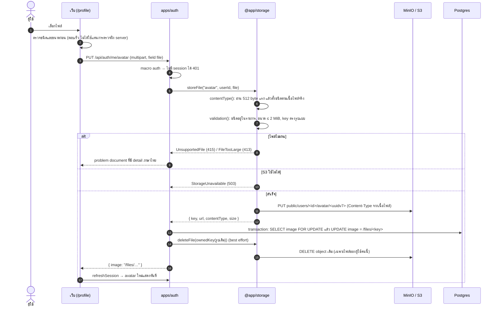
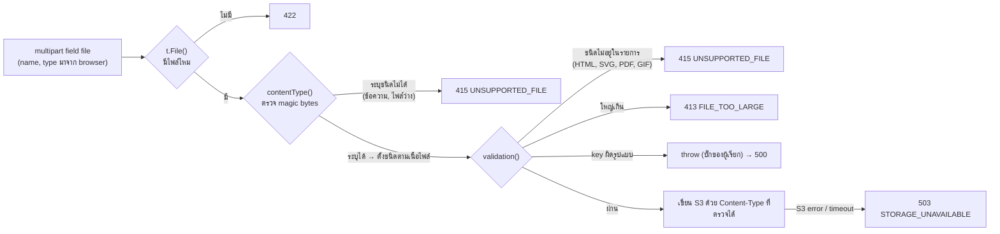
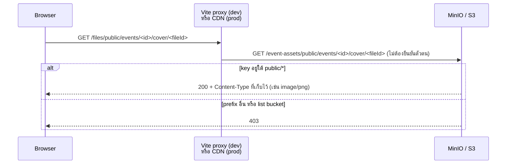
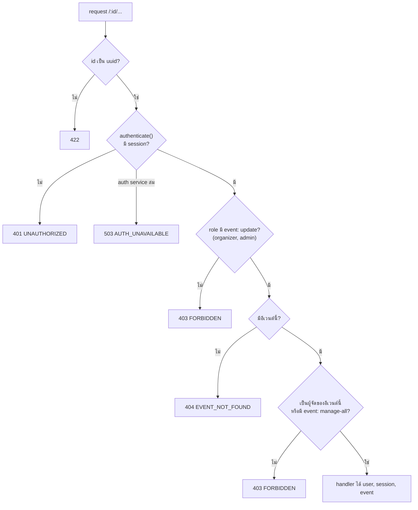

# การจัดการไฟล์ (Storage)

เอกสารนี้อธิบายว่า Eventide เก็บรูปโปรไฟล์ ปกอีเวนต์ และแกลเลอรีรูปของอีเวนต์อย่างไร ใครอัปโหลดอะไรได้ และไฟล์ถูกตรวจ แสดง และลบอย่างไร

- **ไฟล์อยู่ใน S3 ที่เดียว:** bucket `event-assets` (ตอน dev คือ MinIO)
- **`@app/storage` เป็น library ไม่ใช่ service:** แต่ละ service import ไปใช้ในโปรเซสของตัวเองแล้วคุยกับ S3 ตรง จึงไม่มีพอร์ตหรือ network hop เพิ่ม
- **ไฟล์ขึ้นผ่าน service เจ้าของข้อมูลเสมอ:** service ตรวจสิทธิ์ ตรวจไฟล์ เขียน S3 และบันทึก DB จบใน request เดียว
- **DB เก็บแค่ key:** เว็บโหลดไฟล์จาก `/files/<key>`

## สารบัญ

1. [ภาพรวม](#1-ภาพรวม)
2. [ประเภทไฟล์และรูปแบบ key](#2-ประเภทไฟล์และรูปแบบ-key)
3. [การอัปโหลด](#3-การอัปโหลด)
4. [การตรวจไฟล์](#4-การตรวจไฟล์)
5. [การแสดงไฟล์](#5-การแสดงไฟล์)
6. [การเปลี่ยนและลบไฟล์](#6-การเปลี่ยนและลบไฟล์)
7. [Endpoint และสิทธิ์](#7-endpoint-และสิทธิ์)
8. [เมื่อมีส่วนใดล่ม และข้อจำกัดที่รู้อยู่](#8-เมื่อมีส่วนใดล่ม-และข้อจำกัดที่รู้อยู่)
9. [ทำไมออกแบบแบบนี้](#9-ทำไมออกแบบแบบนี้)
10. [เพิ่มประเภทไฟล์หรือใช้ใน service ใหม่](#10-เพิ่มประเภทไฟล์หรือใช้ใน-service-ใหม่)
11. [การทดสอบ](#11-การทดสอบ)
12. [การตั้งค่าและ production](#12-การตั้งค่าและ-production)
13. [ไฟล์ที่เกี่ยวข้อง](#13-ไฟล์ที่เกี่ยวข้อง)

---

## 1. ภาพรวม



- **เขียนผ่าน service เท่านั้น:** browser ไม่ได้ถือ credential ของ S3 และไม่ได้อัปตรงไปที่ bucket
- **อ่านตรงจาก bucket:** เฉพาะ prefix `public/*` ที่ bucket policy เปิดให้อ่านแบบไม่ต้องยืนยันตัวตน ส่วน prefix อื่นยัง private ([ข้อ 5](#5-การแสดงไฟล์))
- **`@app/storage` สร้างบน [files-sdk](https://files-sdk.dev)** โดยใช้เฉพาะส่วน core: adapter `bun-s3` (ใช้ `Bun.S3Client` ไม่ต้องลง AWS SDK) และ plugin `contentType` กับ `validation`

## 2. ประเภทไฟล์และรูปแบบ key

ทุกประเภทไฟล์กำหนดไว้ที่เดียวใน [`packages/storage/src/kinds.ts`](../packages/storage/src/kinds.ts)

| kind | ใช้กับ | ชนิดที่รับ | ขนาดสูงสุด | ตัวอย่าง key |
|---|---|---|---|---|
| `avatar` | รูปโปรไฟล์ | JPEG, PNG, WebP | 2 MiB | `public/users/<userId>/avatar/<fileId>` |
| `eventCover` | ปกอีเวนต์ | JPEG, PNG, WebP | 5 MiB | `public/events/<eventId>/cover/<fileId>` |
| `eventAsset` | แกลเลอรีรูปของอีเวนต์ (สูงสุด 20 รูป) | JPEG, PNG, WebP | 10 MiB | `public/events/<eventId>/assets/<fileId>` |

รูปแบบ key คือ `public/<users|events>/<ownerId>/<folder>/<fileId>`:
- **`ownerId` เป็น uuid ของเจ้าของ:** id ของ user หรือ event
- **`fileId` เป็น uuidv7 ที่สุ่มใหม่ทุกครั้ง:** ไฟล์ใหม่จึงไม่เคยเขียนทับไฟล์เดิม และ URL เดาไม่ได้ uuidv7 ยังเรียงตามเวลาได้ด้วย
- **ไม่มีนามสกุลไฟล์:** S3 เก็บ Content-Type ที่ตรวจได้จากเนื้อไฟล์จริง และส่ง header นั้นกลับตอนเสิร์ฟ
- **ล็อกรูปแบบด้วย regex:** `keyPattern(kind)` บังคับว่า id ทั้งสองต้องเป็น uuid จึงใส่ `..` หรือ path แปลกๆ ไม่ได้ ถ้า service ส่ง `ownerId` ที่ไม่ใช่ uuid มา `storeFile` จะ throw เพราะเป็นบั๊กของผู้เรียก ไม่ใช่ปัญหาของไฟล์

**DB เก็บอะไร:**

| คอลัมน์ | เก็บ | ทำไม |
|---|---|---|
| `events.cover_image_key` | key | ตามกฎ "เก็บ key ไม่เก็บ URL" เปลี่ยน CDN หรือโดเมนภายหลังได้โดยไม่ต้องแก้ข้อมูล |
| `event_assets.key`, `content_type`, `size` | key + metadata | ให้รายการแกลเลอรีตอบได้โดยไม่ต้องถาม S3 |
| `users.image` | path `/files/<key>` (**ข้อยกเว้น**) | เป็น field ของ Better Auth และ Google เขียน URL เต็มลงช่องนี้ จึงต้องเป็นค่าที่ใส่ใน `` ได้ทันที |

response ของ API แปลง key เป็น URL ด้วย `fileUrl(key)` ซึ่งคืน `/files/<key>` ฝั่งเว็บจึงไม่ต้อง import `@app/storage`

## 3. การอัปโหลด

ตัวอย่างการเปลี่ยนรูปโปรไฟล์ ส่วนปกอีเวนต์และแกลเลอรีใช้ขั้นตอนเดียวกัน ต่างกันที่ service และตารางที่บันทึก



- **route ประกาศแค่ `t.File()`:** ไม่ใส่ `type` หรือ `maxSize` ใน schema แต่ให้ `storeFile` ตรวจทั้งหมด error จึงเป็นภาษาไทยแบบเดียวกันทุกกรณี และ Elysia 2 ไม่ต้องลงตัวตรวจชนิดไฟล์ (`setFileTypeDetector`) เพิ่ม
- **`storeFile` คืน error ไม่ throw:** ตาม convention ของโปรเจกต์ Eden และ OpenAPI จึงเห็น error เหล่านี้ใน type
- **เขียน object ก่อน แล้วค่อยบันทึก DB:** ถ้า DB ล้มหลังเขียน object ผลที่ได้คือไฟล์กำพร้า ซึ่งดีกว่าให้ DB ชี้ไปที่ไฟล์ที่ไม่มีอยู่

## 4. การตรวจไฟล์



**ลำดับของ plugin สำคัญ:** `contentType()` ต้องมาก่อน `validation()` เพื่อให้ validation ตรวจ**ชนิดจริง**ของไฟล์ ไม่ใช่ชนิดที่ browser อ้าง ถ้าสลับลำดับกัน ไฟล์ HTML ที่ตั้งชื่อเป็น `.png` จะผ่าน validation ไปก่อน แล้วค่อยถูกเปลี่ยนชนิดเป็น `text/html` ทีหลัง

ตัวอย่างผลการตรวจ:

| ไฟล์ที่ส่งมา | ผล |
|---|---|
| PNG จริง ที่ browser บอกว่า `image/jpeg` | ผ่าน แต่เก็บเป็น `image/png` |
| ไฟล์ข้อความ ที่ตั้งชื่อเป็น `me.png` | 415: ระบุชนิดจากเนื้อไฟล์ไม่ได้ |
| `<!doctype html><script>…` ที่บอกว่า `image/png` | 415: เนื้อไฟล์เป็น HTML |
| PDF | 415: ไม่อยู่ในรายการชนิดที่รับ |
| PNG ขนาด 2 MiB + 1 byte สำหรับ avatar | 413 |

**ทำไมต้องตรวจจากเนื้อไฟล์:** bucket เสิร์ฟไฟล์ใต้ `public/` ให้ทุกคนอ่านได้ ถ้าเก็บไฟล์ HTML หรือ SVG ที่มีสคริปต์ไว้ในชื่อของรูป แล้วมีคนเปิดลิงก์ตรง ไฟล์นั้นอาจรันสคริปต์ได้ (stored XSS) การเชื่อเฉพาะชนิดที่เนื้อไฟล์ยืนยันได้จึงกันปัญหานี้ตั้งแต่ต้นทาง

error ทั้งหมดเป็น problem document ที่มี `detail` ภาษาไทย ฝั่งเว็บแสดงด้วย `problemMessage(error)`

| code | status | detail |
|---|---|---|
| `UNSUPPORTED_FILE` | 415 | รองรับเฉพาะไฟล์รูป JPEG, PNG หรือ WebP |
| `FILE_TOO_LARGE` | 413 | ไฟล์มีขนาดใหญ่เกินกำหนด |
| `STORAGE_UNAVAILABLE` | 503 | ระบบจัดเก็บไฟล์ไม่พร้อมใช้งาน กรุณาลองใหม่อีกครั้ง |

## 5. การแสดงไฟล์



- **bucket policy:** `minio-init` ใน `docker-compose.yml` ตั้งให้ `s3:GetObject` แบบ anonymous ได้**เฉพาะ** `arn:aws:s3:::event-assets/public/*` เท่านั้น การ list bucket และการอ่าน prefix อื่นได้ 403
- **Vite proxy:** `/files/*` ถูก rewrite เป็น `/event-assets/*` แล้วส่งต่อไป `http://localhost:9000` (ดู `apps/web/vite.config.ts`)
- **URL คงที่:** URL ของไฟล์ไม่เปลี่ยนตลอดอายุไฟล์ เพราะทุกการอัปโหลดได้ key ใหม่ browser และ CDN จึง cache ได้เต็มที่
- **ไฟล์ลับในอนาคต** (เช่น สลิปโอนเงิน หรือไฟล์แนบในฟอร์ม) ให้เก็บนอก `public/` แล้วแจก URL แบบ presigned ที่มีอายุสั้น แทนการเปิดให้อ่านตรง

## 6. การเปลี่ยนและลบไฟล์

หลักคือ **"commit key ใหม่ก่อน แล้วค่อยลบไฟล์เก่า"**

| ขั้น | ทำอะไร | ถ้าล้ม |
|---|---|---|
| 1. `storeFile` | เขียน object ใหม่ด้วย key ใหม่ | ไม่มีอะไรเปลี่ยน คืน 413 / 415 / 503 |
| 2. transaction | `SELECT … FOR UPDATE` อ่านค่าเดิม แล้ว `UPDATE` เป็นค่าใหม่ | DB ยังชี้ไฟล์เดิม ส่วน object ใหม่กลายเป็นไฟล์กำพร้า |
| 3. `deleteFile(เดิม)` | ลบ object เดิมแบบ best effort | log error แล้วจบ request ตามปกติ (object เดิมกลายเป็นไฟล์กำพร้า) |

- **lock แถวที่จะแก้:** ถ้ามีการอัปโหลดสองครั้งพร้อมกัน แต่ละครั้งจะได้ค่าเดิมคนละค่า จึงลบได้ตรงไฟล์ที่ตัวเองแทนที่ ไม่มีไฟล์ค้าง
- **`deleteFile` ไม่ throw:** key ที่ไม่มีอยู่แล้ว (`NotFound`) ถือว่าลบสำเร็จ error อื่นแค่ log เพราะ DB เป็น source of truth และไฟล์กำพร้าดีกว่า request ที่ล้มหลัง commit ไปแล้ว
- **`ownedKey(url, kind, ownerId)` ป้องกันการลบผิดไฟล์:** ฟังก์ชันจะคืน key เฉพาะเมื่อ URL เป็นไฟล์ของ kind และเจ้าของนั้นจริง
  - กรณีที่ได้ `null` และจะไม่ลบอะไร:
    - รูปจาก Google (`https://lh3.googleusercontent.com/…`)
    - path ไปที่ไฟล์ของผู้ใช้อื่น
    - path ที่มี `..`
  - ที่ต้องมีเพราะ Better Auth `update-user` ยอมให้ผู้ใช้ตั้ง `image` เป็นค่าอะไรก็ได้ ถ้าไม่มีการตรวจนี้ ผู้ใช้จะตั้ง image ชี้ไปที่รูปของคนอื่น แล้วกดลบรูปเพื่อลบไฟล์ของคนนั้นได้

**การลบที่เกิดขึ้นเอง:**

| เหตุการณ์ | ไฟล์ที่ลบ | ที่ไหน |
|---|---|---|
| เปลี่ยนหรือลบรูปโปรไฟล์ | รูปเดิม | `apps/auth/src/routes/avatar/service.ts` |
| ลบบัญชี | รูปโปรไฟล์ | `databaseHooks.user.delete.after` ใน `apps/auth/src/libs/auth.ts` |
| เปลี่ยนหรือลบปก | ปกเดิม | `apps/event/src/routes/media/service.ts` |
| ลบรูปในแกลเลอรี | รูปนั้น | `apps/event/src/routes/media/service.ts` |
| แกลเลอรีเต็มระหว่างอัปโหลด | object ที่เพิ่งอัปขึ้นไป | `addAsset` (ตรวจซ้ำใต้ lock) |

**ลบบัญชีที่ยังเป็นผู้จัดอีเวนต์ไม่ได้:**
- `events.organizer_id` เป็น `ON DELETE RESTRICT` เพื่อไม่ให้การลบผู้จัดงานพาอีเวนต์ (และตั๋วในอนาคต) หายไปด้วยโดยไม่ตั้งใจ
- Better Auth ลบ sessions และ accounts **ก่อน** ลบแถว user ถ้าปล่อยให้ FK ขวางตอนลบแถว user บัญชีจะค้างอยู่โดยไม่มีวิธีเข้าสู่ระบบ
- ระบบจึงตรวจตั้งแต่ก่อน Better Auth เริ่มลบ แล้วตอบ 403 `ORGANIZER_HAS_EVENTS` ใน 2 จุด:
  - `user.deleteUser.beforeDelete` สำหรับการลบบัญชีตัวเอง
  - `hooks.before` ที่ path `/admin/remove-user` สำหรับ admin ลบผู้ใช้

## 7. Endpoint และสิทธิ์

### รูปโปรไฟล์ (`apps/auth`)

| Endpoint | ใครเรียกได้ | ทำอะไร |
|---|---|---|
| `PUT /api/auth/me/avatar` | ผู้ที่เข้าสู่ระบบ (`auth: true`) | body `file` → `{ image: "/files/…" }` |
| `DELETE /api/auth/me/avatar` | ผู้ที่เข้าสู่ระบบ | ตั้ง `users.image = null` และลบไฟล์ของเรา → `{ image: null }` |

### ปกและแกลเลอรีของอีเวนต์ (`apps/event`)

| Endpoint (`/api/events`) | ใครเรียกได้ | ทำอะไร |
|---|---|---|
| `PUT /:id/cover` | เจ้าของอีเวนต์หรือ admin | body `file` → `{ coverUrl }` และลบปกเดิม |
| `DELETE /:id/cover` | เจ้าของอีเวนต์หรือ admin | → `{ coverUrl: null }` |
| `GET /:id/assets` | ทุกคน (ไม่ต้องเข้าสู่ระบบ) | รายการรูป `[{ id, url, contentType, size, createdAt }]` |
| `POST /:id/assets` | เจ้าของอีเวนต์หรือ admin | เพิ่มรูป สูงสุด 20 รูปต่ออีเวนต์ เกินได้ 409 `ASSET_LIMIT_REACHED` |
| `DELETE /:id/assets/:assetId` | เจ้าของอีเวนต์หรือ admin | ลบรูปนั้น ถ้ารูปไม่ได้อยู่ในอีเวนต์นี้ได้ 404 `ASSET_NOT_FOUND` |

สิทธิ์ของ route ที่แก้ไฟล์ตรวจด้วย macro `eventOwner: true` ใน [`apps/event/src/plugins/event-owner.ts`](../apps/event/src/plugins/event-owner.ts)



- **macro นี้เรียก `authenticate()` จาก `@app/auth-guard` เอง:** macro อ่านค่าที่ macro อื่น (`auth`, `role`) derive ไว้ไม่ได้ จึงต้องตรวจ session เอง ผลที่ได้เหมือน `authGuard` ทุกอย่าง ทั้ง Redis cache และการเพิกถอนทันที ([docs/auth.md ข้อ 4](auth.md#4-service-อื่นรู้ได้อย่างไรว่าใครเรียก))
- **handler ได้ `event` ที่โหลดไว้แล้ว:** จึงไม่ต้อง query ซ้ำ และไม่มีการเช็คความเป็นเจ้าของกระจายอยู่ใน handler

### ฝั่งเว็บ

- **ตอนนี้มีที่เดียว:** `AvatarPicker` (`apps/web/src/routes/_authed/profile/-components/avatar-picker.tsx`) มีปุ่ม "เปลี่ยนรูป" กับ "ลบรูป"
  - ตรวจชนิดและขนาดก่อนส่งเพื่อให้ตอบผู้ใช้ได้เร็ว
  - เรียก `authClient.api.auth.me.avatar.put({ file })` ซึ่ง Eden แปลงเป็น multipart ให้
  - จากนั้นเรียก `refreshSession()` ให้ avatar ใหม่แสดงทันที
- **ปกและแกลเลอรี:** type ของ Eden พร้อมแล้ว (`eventClient.api.events({ id }).cover.put({ file })`) ส่วน UI จะทำพร้อมหน้าจัดการอีเวนต์

## 8. เมื่อมีส่วนใดล่ม และข้อจำกัดที่รู้อยู่

| สถานการณ์ | ผลที่เกิด |
|---|---|
| MinIO / S3 ล่ม | อัปโหลดได้ 503 `STORAGE_UNAVAILABLE` ส่วนการลบแค่ log ไว้ endpoint อื่น (login, ดูอีเวนต์, ลงทะเบียน) ใช้ได้ตามปกติเพราะ DB เก็บแค่ key รูปไม่ขึ้น แต่หน้าเว็บยัง render ได้ (`UserAvatar` แสดงตัวอักษรย่อแทน) |
| Postgres ล่มหลังเขียน object | request ล้ม DB ยังชี้ไฟล์เดิม และ object ใหม่กลายเป็นไฟล์กำพร้า |
| auth service ล่ม | `apps/event` ได้ 503 `AUTH_UNAVAILABLE` เมื่อ cache miss (เหมือน route อื่น) |
| อัปโหลดพร้อมกันหลายครั้ง | lock แถวทำให้แต่ละครั้งลบเฉพาะไฟล์ที่ตัวเองแทนที่ แกลเลอรีตรวจจำนวนซ้ำใต้ lock จึงไม่เกิน 20 รูป |

**ข้อจำกัดที่รู้อยู่ (ยังไม่ได้แก้):**
- **ผู้ใช้ตั้ง `image` ผ่าน `POST /api/auth/update-user` ได้:** Better Auth ยอมให้ตั้งเป็น URL อะไรก็ได้ ถ้าทำแบบนี้ รูปที่เคยอัปไว้จะกลายเป็นไฟล์กำพร้า แต่ไม่กระทบไฟล์ของคนอื่นเพราะมี `ownedKey`
- **ลบอีเวนต์ไม่ได้ลบไฟล์:** cascade ลบแค่แถวใน `event_assets` ตอนทำ endpoint ลบอีเวนต์ต้องลบ object ใต้ `public/events/<id>/` ด้วย
- **ยังไม่มี job เก็บกวาดไฟล์กำพร้า:** ไฟล์กำพร้าเกิดได้เมื่อ DB หรือการลบล้มเท่านั้น หาได้ด้วยการเทียบ key ใน bucket กับคอลัมน์ใน DB

## 9. ทำไมออกแบบแบบนี้

### ไฟล์ขึ้นทางไหน

| | ขั้นตอน | ตรวจไฟล์ | ข้อเสีย |
|---|---|---|---|
| **A. ผ่าน service (ที่เลือก)** | 1 request: multipart ไปที่ service เจ้าของข้อมูล | ก่อนเขียน S3 จากเนื้อไฟล์จริง | ไฟล์วิ่งผ่าน service จึงไม่เหมาะกับไฟล์ใหญ่ระดับ 100 MB ขึ้นไป |
| B. Presigned PUT | 3 ขั้น: ขอ URL → browser PUT ตรงไป S3 → แจ้ง service | หลังอัปเสร็จเท่านั้น (presigned PUT จำกัดขนาดไม่ได้) | ต้องตั้ง CORS บน bucket, browser ต้องเข้าถึง S3 ได้ และมีไฟล์ขยะเมื่อผู้ใช้ทิ้งกลางทาง |
| C. Gateway ของ files-sdk (`files-sdk/api`) | browser คุยกับ endpoint ไฟล์กลาง | ได้ | การตรวจสิทธิ์ตามโดเมนกับการบันทึก DB หลุดออกจาก request เดียวกัน และไม่ได้ type จาก Eden |

ไฟล์ของ Eventide เป็นรูปขนาดไม่เกิน 10 MB แบบ A จึงง่ายที่สุดและปลอดภัยที่สุด

### อ่านไฟล์ทางไหน

| | URL | cache | เหมาะกับ |
|---|---|---|---|
| **prefix `public/` + `/files/<key>` (ที่เลือก)** | คงที่ตลอดอายุไฟล์ | browser และ CDN cache ได้ | ข้อมูลสาธารณะ: รูปโปรไฟล์ ปกอีเวนต์ แกลเลอรี |
| bucket private + presigned GET | เปลี่ยนทุก response และหมดอายุ | cache ไม่ได้ ต้อง sign ทุกครั้ง | ไฟล์ลับ (ใช้ได้ภายหลังกับ prefix อื่นที่ไม่ใช่ `public/`) |

presigned GET ใช้กับ `users.image` ไม่ได้ เพราะ session ของ Better Auth เก็บ URL ที่หมดอายุไม่ได้

### ทำไมเป็น library ไม่ใช่ file service

- **ไม่มี single point of failure ใหม่:** ถ้าทำเป็น service แยก (เช่น `apps/storage`) ทุกการอัปโหลดต้องผ่านมัน และเมื่อมันล่มทุก service จะอัปไฟล์ไม่ได้พร้อมกัน
- **สิทธิ์อยู่กับโดเมน:** เฉพาะ event service ที่รู้ว่าใครเป็นเจ้าของอีเวนต์ file service กลางจะต้องรู้กฎของทุกโดเมน
- **ของที่ใช้ร่วมกันจริงคือ S3:** เหมือน Postgres และ Redis ส่วน AWS S3 ใน production เป็น managed service ที่ availability สูง

### ทำไมใช้ files-sdk

ได้ตัวตรวจชนิดไฟล์ที่ครอบคลุมกรณี HTML/SVG ปลอมตัว, validation, adapter `bun-s3` และ adapter `memory` สำหรับเทส โดยไม่ต้องเขียนเอง ส่วนที่เขียนเองจึงเหลือแค่ wrapper บางๆ สำหรับ kind, การแปลง error เป็นภาษาไทย และ `fileUrl` / `ownedKey`

## 10. เพิ่มประเภทไฟล์หรือใช้ใน service ใหม่

**1. เพิ่ม kind** ใน `packages/storage/src/kinds.ts`:

```ts
export const fileKinds = {
  // ...
  ticketTypeImage: { owner: "events", folder: "ticket-types", types: imageTypes, maxSize: 2 * MiB },
} as const satisfies Record<string, FileKindConfig>;
```

ถ้าเป็นไฟล์ที่ไม่ควรเปิดให้ทุกคนอ่าน ให้ออกแบบ prefix ใหม่นอก `public/` แล้วแจก URL แบบ presigned แทน `fileUrl`

**2. ใช้ใน service** (เพิ่ม `"@app/storage": "workspace:*"` ใน `package.json` ของ service ก่อน):

```ts
// routes/<feature>/model.ts
export const ByIdImagePut = {
  Params: t.Object({ id: t.String({ format: "uuid" }) }),
  Body: t.Object({ file: t.File() }), // ไม่ใส่ type / maxSize: storeFile ตรวจเอง
};

// routes/<feature>/service.ts
import { deleteFile, storeFile } from "@app/storage";

export async function setImage(ownerId: string, file: File) {
  const stored = await storeFile("ticketTypeImage", ownerId, file);
  if (stored instanceof Error) return stored; // 413 / 415 / 503
  const previousKey = await saveKeyInTransaction(ownerId, stored.key); // SELECT … FOR UPDATE แล้ว UPDATE
  await deleteFile(previousKey); // ลบไฟล์เก่าหลัง commit เสมอ
  return { imageUrl: stored.url };
}
```

**3. ตรวจสิทธิ์** ด้วย macro ใน `plugins/` (ดู `eventOwner` เป็นตัวอย่าง) ไม่เขียนการเช็คไว้ใน handler

## 11. การทดสอบ

| ชุดเทส | ใช้ storage แบบไหน | ครอบคลุม |
|---|---|---|
| `packages/storage/test/storage.test.ts` | memory + MinIO จริง 1 เคส | ตรวจชนิดจากเนื้อไฟล์, HTML ปลอมตัว, ชนิดนอกรายการ, ขนาดเกิน, `ownedKey`, `deleteFile` |
| `apps/auth/test/avatar.test.ts` | MinIO จริง | อัป, แทนที่แล้วลบไฟล์เดิม, 415, ไม่ลบไฟล์ของคนอื่น, ลบบัญชีแล้วไฟล์หาย, `ORGANIZER_HAS_EVENTS` ที่ไม่ทำให้บัญชีเสีย |
| `apps/event/test/media.test.ts` | memory | สิทธิ์ทุกบทบาท, 404/422, แทนที่ปก, asset ข้ามอีเวนต์, เพดาน 20 รูป |

- **`useMemoryStorage()`** จาก `@app/storage/testing` สลับ adapter เป็น `memory()` ของ files-sdk แล้วคืน store ไว้ assert เช่น `store.exists(key)` service อื่นจึงไม่ต้องลง `files-sdk` เอง
- **เทสของ `apps/event` ไม่ต้องเปิด auth service:** ใช้ `mock.module("@app/auth-guard", …)` สร้าง `authGuard` และ `authenticate` ใหม่ด้วย resolver ปลอมที่แปลง cookie เป็นผู้ใช้ที่ seed ไว้
- **รัน:** `bun run test` ใน `packages/storage`, `apps/auth` และ `apps/event` (ต้อง `bun run infra:up` ก่อน)

## 12. การตั้งค่าและ production

ตัวแปรใน `.env` ที่ root (ดู `.env.example`) adapter `bun-s3` สร้าง `Bun.S3Client` ที่อ่านค่าเหล่านี้เอง:

| ตัวแปร | ใช้ทำอะไร |
|---|---|
| `S3_ENDPOINT` | endpoint ของ S3 (`http://localhost:9000` ตอน dev) ใช้ path-style ซึ่งเป็นค่าเริ่มต้นของ Bun |
| `S3_BUCKET` | `event-assets` |
| `S3_REGION` | region ของ bucket |
| `S3_ACCESS_KEY_ID` / `S3_SECRET_ACCESS_KEY` | credential ของ service (ตอน dev คือ root user ของ MinIO) |
| `MINIO_ROOT_USER` / `MINIO_ROOT_PASSWORD` | credential ของ container MinIO และ `minio-init` |

- **MinIO console:** http://localhost:9001 ใช้ดู object ที่อัปขึ้นไป
- **รัน `minio-init` ใหม่:** ถ้าแก้ bucket policy แล้ว `bun run infra:up` ไม่สร้าง container ใหม่ ให้รัน `docker compose up -d minio-init`

**ก่อน deploy production:**
- **route `/files/*` ไปที่ bucket:** เช่น CloudFront ที่มี origin เป็น bucket และตัด prefix `/files` ออก หรือใช้ reverse proxy แบบเดียวกับ Vite proxy ตอน dev ถ้าเปลี่ยน path นี้ `users.image` ที่เก็บไว้แล้วจะเสีย
- **ตั้ง bucket policy เดียวกัน:** อ่านได้เฉพาะ `public/*` หรือใช้ CloudFront Origin Access Control แล้วปิด bucket ทั้งหมด
- **แยก IAM credential ต่อ service** ให้เขียนได้เฉพาะ prefix ของตัวเอง: `apps/auth` → `public/users/*` และ `apps/event` → `public/events/*` ถ้า service ใดถูกเจาะ จะลบไฟล์ของโดเมนอื่นไม่ได้
- **ใช้ AWS S3 แทน MinIO:** ลบ `S3_ENDPOINT` ออกหรือตั้งเป็น endpoint ของ region นั้น โค้ดไม่ต้องแก้

## 13. ไฟล์ที่เกี่ยวข้อง

| ไฟล์ | หน้าที่ |
|---|---|
| `packages/storage/src/kinds.ts` | ประเภทไฟล์ ชนิดที่รับ ขนาด และรูปแบบ key |
| `packages/storage/src/store.ts` | `storeFile`, `deleteFile`, `fileUrl`, `ownedKey`, `setStorageAdapter` และ instance ของ files-sdk |
| `packages/storage/src/errors.ts` | `UnsupportedFile`, `FileTooLarge`, `StorageUnavailable` |
| `packages/storage/src/testing.ts` | `useMemoryStorage()` สำหรับเทส |
| `apps/auth/src/routes/avatar/` | controller, model และ service ของรูปโปรไฟล์ |
| `apps/auth/src/libs/auth.ts` | ลบรูปเมื่อลบบัญชี และกันการลบบัญชีของผู้จัดงาน (`ORGANIZER_HAS_EVENTS`) |
| `apps/event/src/plugins/event-owner.ts` | macro `eventOwner` |
| `apps/event/src/routes/media/` | controller, model และ service ของปกและแกลเลอรี |
| `packages/db/src/schema/event.ts` | `events.organizer_id`, `events.cover_image_key` และตาราง `event_assets` |
| `packages/auth-guard/src/plugin.ts` | `createAuthenticator` / `authenticate` ที่ macro ของ service ใช้ |
| `docker-compose.yml` | MinIO, bucket `event-assets` และ bucket policy ของ `public/*` |
| `apps/web/vite.config.ts` | proxy `/files/*` ไปที่ bucket |
| `apps/web/src/routes/_authed/profile/-components/avatar-picker.tsx` | ปุ่มเปลี่ยนและลบรูปโปรไฟล์ |
