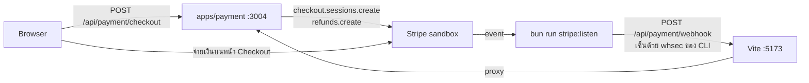

# การตั้งค่า Stripe

เอกสารนี้พาตั้งค่า Stripe ให้ `apps/payment` ตั้งแต่สร้าง sandbox จนรับ webhook ได้ ทั้งในเครื่องและบน production ส่วนวงจรการชำระเงิน การคืนเงิน และข้อจำกัด อยู่ใน [docs/tickets.md](tickets.md#6-การชำระเงิน)

- **Sandbox คือสภาพแวดล้อมทดสอบของ Stripe:** การตั้งค่าและข้อมูลแยกจาก live mode จ่ายด้วยบัตรทดสอบ ไม่มีเงินจริง
- **ระบบรู้ว่าจ่ายแล้วจาก webhook เท่านั้น:** การกลับมาที่หน้า success ไม่ได้ยืนยันอะไร ถ้า webhook ไม่มาถึง บิลจะค้างที่ "รอชำระเงิน"
- **ต้องตั้งค่าสองตัว:** `STRIPE_SECRET_KEY` (คีย์ของ sandbox) และ `STRIPE_WEBHOOK_SECRET` (`whsec_…` ของสิ่งที่ส่ง webhook มา)

## สารบัญ

1. [ภาพรวม](#1-ภาพรวม)
2. [สร้าง sandbox](#2-สร้าง-sandbox)
3. [สร้าง API key](#3-สร้าง-api-key)
4. [เชื่อม Stripe CLI](#4-เชื่อม-stripe-cli)
5. [รับ webhook ในเครื่อง](#5-รับ-webhook-ในเครื่อง)
6. [ทดสอบการชำระเงิน](#6-ทดสอบการชำระเงิน)
7. [แก้ปัญหา](#7-แก้ปัญหา)
8. [Production](#8-production)
9. [ไฟล์ที่เกี่ยวข้อง](#9-ไฟล์ที่เกี่ยวข้อง)

---

## 1. ภาพรวม



- ในเครื่อง Stripe ส่ง event มาที่ `localhost` ตรงๆ ไม่ได้ Stripe CLI (`stripe listen`) จึงรับ event แทนแล้วส่งต่อให้
- บน production Stripe ส่งตรงไปที่ `https://<โดเมน>/api/payment/webhook` (ดู[หัวข้อ 8](#8-production))

| ตัวแปร | ค่า | ได้จาก |
|---|---|---|
| `STRIPE_SECRET_KEY` | `rk_test_…` (แนะนำ) หรือ `sk_test_…` | [หัวข้อ 3](#3-สร้าง-api-key) |
| `STRIPE_WEBHOOK_SECRET` | `whsec_…` | dev: `bun run stripe:listen` ([หัวข้อ 5](#5-รับ-webhook-ในเครื่อง)), prod: webhook endpoint ([หัวข้อ 8](#8-production)) |
| `BETTER_AUTH_URL` | origin ของเว็บ | ใช้สร้าง `success_url` / `cancel_url` ของ Checkout |

ถ้าใส่ live key (`sk_live_` / `rk_live_`) ขณะที่ `NODE_ENV` ไม่ใช่ `production` payment service จะไม่ยอมเริ่มทำงาน

## 2. สร้าง sandbox

- **แต่ละคนในทีมใช้ sandbox ของตัวเอง:** `stripe listen` ส่งต่อ event ทุกตัวของ sandbox ให้ทุกเครื่องที่ฟังอยู่ ถ้าใช้ร่วมกัน event ของเพื่อนจะเข้าเครื่องเราด้วย ระบบไม่สนใจ session ที่ไม่มีใน DB ของตัวเองก็จริง แต่ log จะรกและหาของตัวเองยาก
- **ใช้ sandbox ไม่ใช่ "test mode" เดิมของบัญชี:** Stripe แนะนำ sandbox สำหรับงานใหม่ เพราะแยกการตั้งค่าออกจากกันได้

### ทางที่ 1: สมัครบัญชี Stripe (แนะนำ)

1. สมัครที่ [dashboard.stripe.com/register](https://dashboard.stripe.com/register) ยังไม่ต้องเปิดรับเงินจริง (activate) เพื่อใช้ sandbox
2. ใน Dashboard กด account picker มุมซ้ายบน → **Switch to sandbox** → **Create sandbox**
3. ตั้งชื่อให้รู้ว่าของใคร เช่น `Eventide – <ชื่อคุณ>` แล้วกด **Create sandbox** ส่วนตัวเลือกคัดลอกการตั้งค่าจากบัญชีใช้ค่าเริ่มต้นได้
4. บัญชีหนึ่งมี sandbox ได้สูงสุด 5 อัน

### ทางที่ 2: ยังไม่มีบัญชี (sandbox ชั่วคราว)

```sh
bunx stripe sandbox create --from-git    # หรือ --email you@example.com
```

- คำสั่งนี้ไม่ต้องสมัครบัญชี จะพิมพ์ `secret_key` (`rkcs_test_…`) ออกมา และบันทึกคีย์ลงโปรไฟล์ของ CLI ให้เลย
- เอา `secret_key` ไปใส่ `STRIPE_SECRET_KEY` แล้วข้ามไป[หัวข้อ 5](#5-รับ-webhook-ในเครื่อง) ได้
- **sandbox จะหมดอายุใน 7 วัน** ถ้ายังไม่ claim ให้เปิด `claim_url` ที่พิมพ์ออกมา หรือรัน `bunx stripe sandbox claim` จากนั้นรัน `bunx stripe login` เพื่อรับคีย์ถาวร แล้วสร้างคีย์ตาม[หัวข้อ 3](#3-สร้าง-api-key)

## 3. สร้าง API key

ใช้ **restricted key** (`rk_test_…`) ที่มีสิทธิ์เท่าที่ service ใช้จริง แทน secret key (`sk_test_…`) ที่ทำได้ทุกอย่าง ถ้าคีย์หลุด ความเสียหายจะจำกัดอยู่แค่สิทธิ์ที่ให้ไว้

1. ใน sandbox ไปที่ **Developers → API keys → Create restricted key**
2. ตั้งชื่อ เช่น `eventide-payment` แล้วให้สิทธิ์ตามตารางนี้ ส่วนที่เหลือตั้งเป็น None

   | Resource | สิทธิ์ | ใช้ที่ |
   |---|---|---|
   | Checkout Sessions (`checkout_session_write`) | Write | `checkout.sessions.create` ใน `routes/checkout/service.ts` |
   | Charges and Refunds (`charge_write`) | Write | `refunds.create` ใน `libs/refund.ts` (ผู้ซื้อ/ผู้จัดงานคืนเงิน และเงินที่เข้าหลังหมดเวลาจอง) |

3. คัดลอกคีย์ไปใส่ `.env` ที่ root: `STRIPE_SECRET_KEY=rk_test_…`

ข้อควรรู้:
- **ไม่ต้องใช้ publishable key** (`pk_test_…`) เพราะหน้าชำระเงินเป็นหน้าของ Stripe เว็บของเราไม่ได้โหลด Stripe.js
- **สิทธิ์ refund ขาดไม่ได้:** ถ้าลืมให้ ปุ่มขอคืนเงินของผู้ซื้อและผู้จัดงานจะขึ้น "ระบบคืนเงินขัดข้อง" และ webhook ของเงินที่เข้าหลังหมดเวลาจองจะตอบ 500 ซ้ำๆ
- **ถ้าเจอ 403 จาก Stripe:** เปิดคีย์ → **View request logs** แล้วเพิ่มสิทธิ์ที่ขาด ข้อความ error จะบอกชื่อสิทธิ์

## 4. เชื่อม Stripe CLI

Stripe CLI เป็น devDependency ของ root (`@stripe/cli`) แค่รัน `bun install` ก็ใช้ได้ เรียกผ่าน `bunx stripe` ไม่ต้องลงผ่าน Homebrew

- ตอน install Bun จะบล็อก postinstall ของแพ็กเกจนี้ ไม่ต้อง `bun pm trust`
- สคริปต์นั้นแค่ดาวน์โหลดไบนารีในกรณีที่แพ็กเกจของแพลตฟอร์มไม่ได้ติดตั้งมา

```sh
bunx stripe login     # เปิดเบราว์เซอร์ ยืนยัน pairing code และเลือก sandbox ของคุณ
bunx stripe whoami    # ดูว่าตอนนี้ CLI ใช้บัญชีหรือ sandbox ไหน
bunx stripe switch    # เปลี่ยน sandbox ถ้ามีหลายอัน
```

**CLI ต้องอยู่ sandbox เดียวกับ `STRIPE_SECRET_KEY`** ไม่อย่างนั้น `stripe listen` จะฟังอีก sandbox หนึ่ง และไม่เห็น event ของการจ่ายเงินในเว็บเรา

## 5. รับ webhook ในเครื่อง

```sh
bun run infra:up
bun run stripe:listen    # เปิดในเทอร์มินัลแยก แล้วเปิดค้างไว้ตลอดที่ทดสอบ
```

`stripe:listen` (ใน `package.json` ที่ root) คือ `stripe listen --events … --forward-to localhost:5173/api/payment/webhook`

- Stripe CLI รุ่นใหม่บังคับให้ระบุ event ที่จะส่งต่อ สคริปต์จึงระบุไว้ 6 ตัวที่ webhook ใช้:
  - `checkout.session.completed`
  - `checkout.session.async_payment_succeeded`
  - `checkout.session.async_payment_failed`
  - `checkout.session.expired`
  - `refund.updated`, `refund.failed`: สถานะของการคืนเงินที่เปลี่ยนภายหลัง (ดู [docs/tickets.md](tickets.md#7-การคืนเงิน))
- event เหล่านี้ส่งแบบ snapshot ซึ่ง handler อ่าน `event.data.object` ได้

ตั้งค่าครั้งแรก:

1. คัดลอก `whsec_…` จากบรรทัด `Ready! Your webhook signing secret is whsec_…` ไปใส่ `.env`: `STRIPE_WEBHOOK_SECRET=whsec_…`
2. รีสตาร์ต `bun run dev` เพราะ service อ่าน `.env` ตอนเริ่มเท่านั้น (`--watch` ไม่ได้ดูไฟล์ `.env`)

`whsec_…` ของ CLI ไม่เปลี่ยนเมื่อรัน `stripe:listen` ใหม่ จึงตั้งแค่ครั้งเดียว

`stripe listen` ส่งต่อเฉพาะ event ที่เกิด**หลัง**เริ่มรัน การจ่ายเงินที่เกิดก่อนหน้า (หรือตอนที่ปิดไว้) จะไม่ถูกส่งมาเอง ต้องสั่งส่งซ้ำตาม[หัวข้อ 7](#7-แก้ปัญหา)

ถ้าทำงานถูก ทุกครั้งที่จ่ายเงินจะเห็น:

```
--> checkout.session.completed [evt_…]
<-- [200] POST http://localhost:5173/api/payment/webhook [evt_…]
```

## 6. ทดสอบการชำระเงิน

บัตรทดสอบใช้ได้เฉพาะใน sandbox วันหมดอายุใส่วันไหนในอนาคตก็ได้ CVC ใส่เลข 3 หลักอะไรก็ได้ ([รายการเต็ม](https://docs.stripe.com/testing))

| บัตร | ผล |
|---|---|
| ✓ `4242 4242 4242 4242` | จ่ายสำเร็จ |
| ⚠️ `4000 0025 0000 3155` | ต้องยืนยัน 3D Secure (กด Complete ในหน้าทดสอบ) |
| ✗ `4000 0000 0000 0002` | ถูกปฏิเสธ (generic decline) |
| ✗ `4000 0000 0000 9995` | ยอดเงินไม่พอ (`insufficient_funds`) |

กรณีที่ควรลองกับระบบเรา:

- **จ่ายสำเร็จ:**
  1. ลงทะเบียนตั๋วที่มีราคา (อย่างน้อย ฿20) แล้วจ่ายด้วย `4242…`
  2. ระบบพากลับมาที่ `/tickets/orders/:id?paid=1` สถานะควรเป็นยืนยันแล้วภายในไม่กี่วินาที และตั๋วขึ้นใน "ตั๋วของฉัน"
  3. ถ้าไม่ได้ตั้ง Gmail อีเมลตั๋วจะอยู่ใน log ของ mail-worker
- **บัตรถูกปฏิเสธ:** หน้า Checkout ให้ลองบัตรอื่น ไม่มี event มาถึงระบบ บิลยังรอชำระตามปกติ
- **Session หมดอายุ:** ไม่ต้องรอ 30 นาที สั่งให้หมดอายุเลยได้
  ```sh
  bunx stripe checkout sessions expire cs_test_…
  ```
  - หา id ได้จาก `payments.stripe_session_id` (`bun run db:studio`)
  - ตั๋ว first_come / invite: การลงทะเบียนจะหมดเวลาและคืนที่นั่ง
  - ตั๋ว approval: ยังจ่ายใหม่ได้จนถึงกำหนด
- **Event ซ้ำ:** `bunx stripe events resend evt_…` สถานะต้องไม่เปลี่ยนซ้ำ และต้องไม่มีอีเมลตั๋วฉบับที่สอง
- **เช็กแค่ว่า webhook ต่อถึง:** `bunx stripe trigger checkout.session.completed`
  - คำสั่งนี้สร้าง session ปลอมที่ไม่มีใน DB ระบบควรตอบ `200` แต่ไม่ทำอะไร
- **ขอคืนเงิน:**
  1. ตั้งนโยบายคืนเงินของอีเวนต์ก่อนลงทะเบียน (นโยบายถูกบันทึกกับการลงทะเบียน ณ ตอนนั้น) แล้วจ่ายด้วย `4242…`
  2. ผู้ซื้อเปิดตั๋ว → "ดูรายการสั่งซื้อ" → "ขอคืนเงิน" หรือผู้จัดงานเปิดแท็บผู้เข้าร่วม → "ดูรายละเอียด" → "คืนเงินเต็มจำนวน"
  3. รายการควรเป็น "ยกเลิกแล้ว" ทันที ที่นั่งกลับมาว่าง และใน Dashboard ของ Stripe ขึ้น refund ตามเปอร์เซ็นต์ที่คืน
  4. แท็บ "คืนเงิน" ของอีเวนต์แสดงรายการนั้น
- **คืนเงินไม่สำเร็จ:** จ่ายด้วยบัตรทดสอบที่ทำให้ refund ล้มเหลวภายหลัง (ดูหัวข้อ Refunds ใน[รายการบัตรทดสอบ](https://docs.stripe.com/testing)) แล้วขอคืนเงิน เมื่อ `refund.failed` มาถึง แท็บ "คืนเงิน" ควรขึ้น "คืนเงินไม่สำเร็จ" และผู้ซื้อได้อีเมลแจ้ง

## 7. แก้ปัญหา

| อาการ | สาเหตุ | วิธีแก้ |
|---|---|---|
| จ่ายแล้วแต่บิลค้าง "รอชำระเงิน" และเทอร์มินัล `stripe:listen` ไม่ขึ้นอะไรเลย | ไม่ได้รัน `stripe:listen` หรือ CLI อยู่คนละ sandbox กับ `STRIPE_SECRET_KEY` | รัน `bun run stripe:listen`, เช็กด้วย `bunx stripe whoami` แล้วส่ง event ซ้ำ (ด้านล่าง) |
| กดชำระเงินซ้ำแล้ว Stripe ขึ้น "คุณดำเนินการเสร็จเรียบร้อยแล้ว / ชำระเงินรายการนี้เรียบร้อยแล้ว" | จ่ายไปแล้วแต่ webhook ไม่มาถึง บิลจึงยัง `pending` และปุ่มชำระเงินพากลับไปที่ session เดิมที่จ่ายแล้ว | ไม่ต้องจ่ายซ้ำ ส่ง event ซ้ำ (ด้านล่าง) |
| ตั้งค่าครบแล้ว แต่บิลที่จ่ายไว้ก่อนเปิด `stripe:listen` ยังค้าง | `stripe listen` ส่งต่อเฉพาะ event ที่เกิดหลังเริ่มรัน | ส่ง event ซ้ำ (ด้านล่าง) |
| ขึ้น `<-- [400]` | `STRIPE_WEBHOOK_SECRET` ไม่ตรง หรือยังไม่ได้รีสตาร์ต `bun run dev` หลังแก้ `.env` | ใส่ `whsec_…` จาก `stripe:listen` รีสตาร์ต แล้วส่ง event ซ้ำ |
| ขึ้น `<-- [500]` | handler พัง เช่น DB ล่ม หรือคีย์ไม่มีสิทธิ์ refund | ดู log ของ `apps/payment` แก้ต้นเหตุ แล้วส่ง event ซ้ำ |
| ขึ้น `connection refused` | ไม่ได้รัน `bun run dev` หรือ payment service ล่ม | เปิด `bun run dev` แล้วส่ง event ซ้ำ |
| กดชำระเงินแล้วขึ้น "ระบบชำระเงินขัดข้อง" | สร้าง Checkout session ไม่ได้ เช่น ไม่ได้ตั้ง `STRIPE_SECRET_KEY` คีย์ผิด หรือคีย์ไม่มีสิทธิ์ Checkout Sessions | ดู log `Failed to create a Stripe Checkout session` ของ `apps/payment` |
| กดคืนเงินแล้วขึ้น "ระบบคืนเงินขัดข้อง" | เรียก `refunds.create` ไม่สำเร็จ เช่น คีย์ไม่มีสิทธิ์ Charges and Refunds หรือ Stripe ล่ม รายการยังไม่ถูกยกเลิก | ดู log `Failed to create a Stripe refund` แก้ต้นเหตุแล้วกดใหม่ |
| กดคืนเงินแล้วขึ้น "Stripe คืนเงินรายการนี้ไม่ได้" | Stripe ปฏิเสธ เช่น ชำระนานเกินกำหนดคืนเงิน หรือคืนเงินไปแล้วจาก Dashboard ของ Stripe | ดู log เดียวกันว่า Stripe ตอบอะไร แล้วคืนเงินทางอื่น |
| payment service ไม่ยอมเริ่ม: `Refusing to use a live Stripe key outside production` | ใส่ live key ในเครื่อง | ใช้คีย์ของ sandbox |

**กู้บิลที่ค้าง:** event ไม่หายไปไหน แก้ต้นเหตุก่อน แล้วสั่งส่งซ้ำมาที่ `stripe:listen` ที่เปิดอยู่

```sh
bunx stripe events list --type=checkout.session.completed --limit=5    # หา evt_…
bunx stripe events resend evt_…
```

ถ้าเลยเวลาจองที่นั่งไปแล้ว ระบบจะยืนยันให้ถ้ายังมีที่นั่งว่าง ถ้าไม่มีแล้วจะคืนเงินให้อัตโนมัติ (ดู [docs/tickets.md](tickets.md#6-การชำระเงิน))

## 8. Production

ใช้ sandbox ได้ทั้ง staging และเว็บเดโม ถ้าจะรับเงินจริงต้อง activate บัญชี แล้วใช้ live key (`rk_live_…`) กับ `NODE_ENV=production`

1. **ให้ endpoint เข้าถึงได้จากภายนอกผ่าน HTTPS:** `https://<โดเมน>/api/payment/webhook`
   - Vite proxy มีแค่ตอน dev บน production ต้องตั้ง reverse proxy / ingress ให้ส่ง `/api/payment/*` ไปที่ payment service
   - proxy ต้องส่ง body ต่อโดย**ไม่แก้ไข** เพราะ Stripe เซ็นลายเซ็นจาก raw body
2. **ลงทะเบียน endpoint:** ใน Dashboard (sandbox หรือ live) ไปที่ **Workbench → Webhooks → Create an event destination**
   - เลือก **Your account**
   - Payload format เลือก **Snapshot** ห้ามเลือก Thin เพราะ handler อ่าน `event.data.object` ซึ่ง thin event ไม่มี
   - เลือก event 6 ตัวเดียวกับใน[หัวข้อ 5](#5-รับ-webhook-ในเครื่อง) (รวม `refund.updated` และ `refund.failed`)
   - Destination type เลือก **Webhook endpoint** แล้วใส่ URL จากข้อ 1
3. **ตั้งค่า secret:** กด **Reveal secret** แล้วเอา `whsec_…` ไปใส่ `STRIPE_WEBHOOK_SECRET` ของ production
   - ค่านี้คนละตัวกับของ CLI และ sandbox กับ live ก็คนละตัวกัน
4. **ตั้ง env อื่น:**
   - `BETTER_AUTH_URL` เป็น origin จริง ใช้ทั้งใน `success_url` / `cancel_url` และลิงก์ในอีเมล
   - `STRIPE_SECRET_KEY` เป็นคีย์ของ environment นั้น
   - เก็บคีย์และ `whsec_…` ใน secret manager (เช่น AWS Secrets Manager หรือ SSM Parameter Store แบบ SecureString) อย่า commit `.env`
5. **ทดสอบ:** จ่ายด้วย `4242…` (sandbox) แล้วดู **Workbench → Webhooks → endpoint → Event deliveries** ควรขึ้น `200`

**ถ้า webhook ส่งไม่สำเร็จ:**
- live mode: Stripe ส่งซ้ำนานสูงสุด 3 วัน
- sandbox: ส่งซ้ำแค่ 3 ครั้งในไม่กี่ชั่วโมง
- หลังจากนั้น บิลจะค้าง "รอชำระเงิน" จนกว่าจะกด **Resend** ใน Event deliveries ของ endpoint นั้น

## 9. ไฟล์ที่เกี่ยวข้อง

| ไฟล์ | หน้าที่ |
|---|---|
| `package.json` (root) | สคริปต์ `stripe:listen` และ devDependency `@stripe/cli` |
| `.env.example` | `STRIPE_SECRET_KEY`, `STRIPE_WEBHOOK_SECRET` |
| `apps/payment/src/libs/stripe.ts` | Stripe client, กันใช้ live key นอก production, `webhookSecret` |
| `apps/payment/src/routes/checkout/` | สร้างหรือใช้ Checkout session เดิม |
| `apps/payment/src/routes/refunds/` | ผู้ซื้อขอคืนเงินตามนโยบาย, ผู้จัดงานคืนเงินเต็มจำนวน, ประวัติการคืนเงินของอีเวนต์ |
| `apps/payment/src/libs/refund.ts` | `refunds.create` พร้อม idempotency key และบันทึกลงตาราง `refunds` |
| `apps/payment/src/routes/webhook/` | ตรวจลายเซ็นและจัดการ 6 event |
| `docs/tickets.md` | วงจรการชำระเงิน การคืนเงิน และข้อจำกัด |
