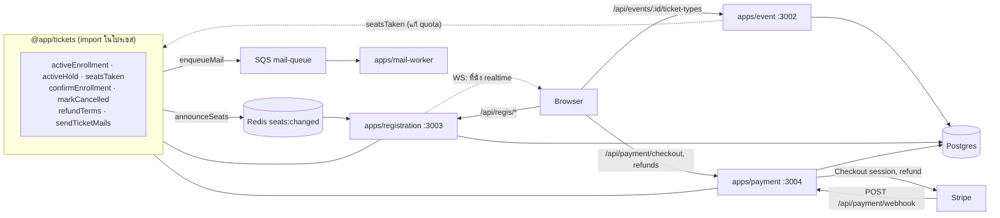
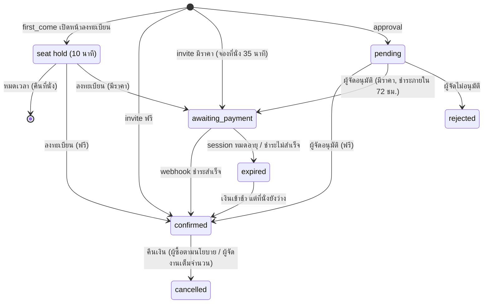
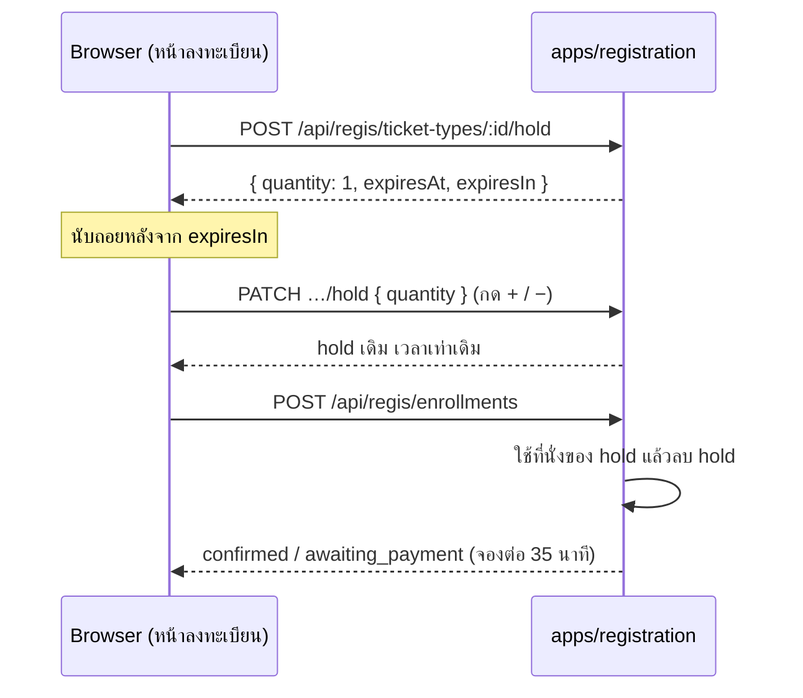
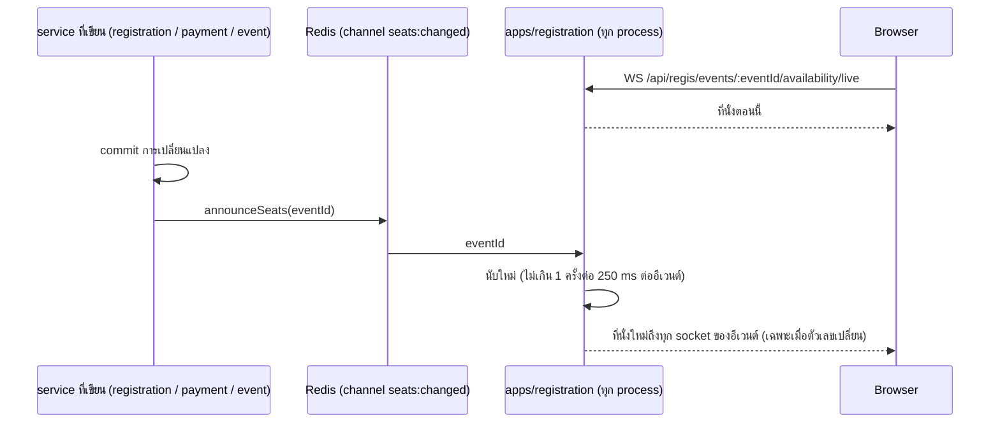
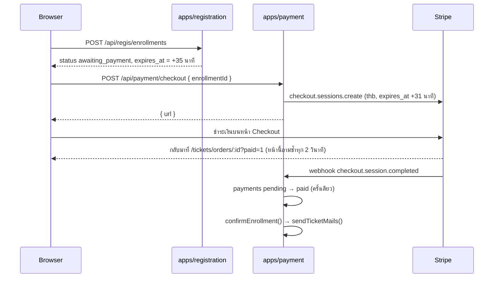
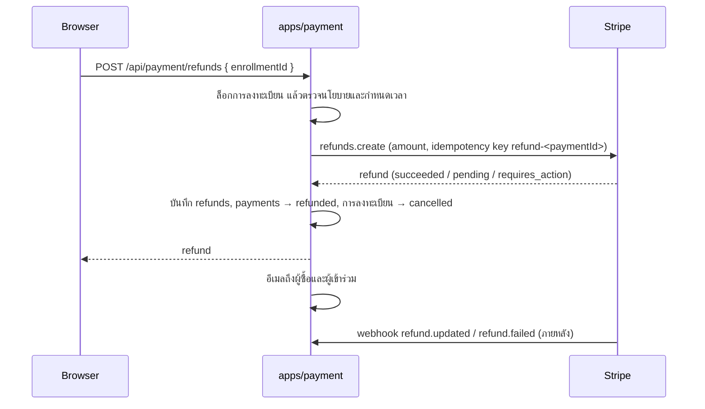

# ระบบตั๋ว (Tickets)

เอกสารนี้อธิบายว่า Eventide ขายและแจกตั๋วอย่างไร ตั้งแต่ผู้จัดสร้างประเภทตั๋วและแบบฟอร์ม จนถึงผู้ซื้อลงทะเบียน ชำระเงิน และผู้เข้าร่วมเห็นตั๋วในบัญชี

- **สาม service แบ่งกันถือข้อมูล:** `apps/event` ถือประเภทตั๋วและแบบฟอร์ม, `apps/registration` ถือการลงทะเบียนและตั๋ว, `apps/payment` ถือการชำระเงินและการคืนเงินผ่าน Stripe
- **`@app/tickets` เป็น library ไม่ใช่ service:** โค้ดที่ registration และ payment ต้องใช้ร่วมกัน (นับที่นั่ง, ยืนยันการลงทะเบียน, ส่งอีเมลตั๋ว) อยู่ที่นี่ ทุก service ใช้ DB เดียวกัน
- **ตั๋ว 1 ใบ = ผู้เข้าร่วม 1 คน:** ผู้ซื้อกรอกชื่อ นามสกุล อีเมล และคำตอบให้ผู้เข้าร่วมทีละคน ตั๋วส่งไปที่อีเมลนั้น และแสดงในบัญชีที่ใช้อีเมลนั้นด้วย

## สารบัญ

1. [ภาพรวม](#1-ภาพรวม)
2. [ประเภทตั๋ว](#2-ประเภทตั๋ว)
3. [แบบฟอร์มลงทะเบียน](#3-แบบฟอร์มลงทะเบียน)
4. [วงจรของการลงทะเบียน](#4-วงจรของการลงทะเบียน)
5. [ที่นั่งและการล็อก](#5-ที่นั่งและการล็อก)
6. [การชำระเงิน](#6-การชำระเงิน)
7. [การคืนเงิน](#7-การคืนเงิน)
8. [ตั๋วของฉัน](#8-ตั๋วของฉัน)
9. [Endpoint และสิทธิ์](#9-endpoint-และสิทธิ์)
10. [เมื่อมีส่วนใดล่ม และข้อจำกัดที่รู้อยู่](#10-เมื่อมีส่วนใดล่ม-และข้อจำกัดที่รู้อยู่)
11. [การทดสอบและการตั้งค่า](#11-การทดสอบและการตั้งค่า)
12. [ไฟล์ที่เกี่ยวข้อง](#12-ไฟล์ที่เกี่ยวข้อง)

---

## 1. ภาพรวม

| ตาราง | เจ้าของ | เก็บอะไร |
|---|---|---|
| `ticket_types` | apps/event | ประเภท (`kind`), ชื่อ, รายละเอียด, ราคา (บาท), `quota`, `max_per_user` |
| `ticket_type_questions` | apps/event | คำถามของแต่ละประเภท เรียงด้วย `position` |
| `seat_holds` | apps/registration | ที่นั่งที่บัญชีจองไว้ระหว่างกรอกแบบฟอร์ม (first_come): จำนวน, `expires_at` บัญชีละ 1 แถวต่อประเภทตั๋ว |
| `enrollments` | apps/registration | การลงทะเบียน 1 ครั้ง: ผู้ซื้อ, จำนวน, ราคาต่อใบและนโยบายคืนเงิน ณ ตอนนั้น, สถานะ, `expires_at` |
| `tickets` | apps/registration | ผู้เข้าร่วม 1 คน: ชื่อ, อีเมล (ตัวเล็ก), `code` สำหรับ QR, `answers` |
| `payments` | apps/payment | Checkout session ของ Stripe ต่อการลงทะเบียน |
| `refunds` | apps/payment | การคืนเงินของ Stripe ไม่เกิน 1 ครั้งต่อการชำระเงิน: ยอด, เปอร์เซ็นต์, สถานะ, ใครขอคืน |

## 2. ประเภทตั๋ว

| `kind` | ชื่อในเว็บ | จำนวนตั๋ว | ใครลงทะเบียนได้ |
|---|---|---|---|
| `first_come` | มาก่อนได้ก่อน | ต้องกำหนด `quota` | ทุกคนที่เปิดอีเวนต์ได้ |
| `approval` | ต้องได้รับอนุมัติ | ไม่จำกัด | ทุกคนที่เปิดอีเวนต์ได้ แล้วผู้จัดอนุมัติทีละรายการ |
| `invite` | เฉพาะผู้ได้รับเชิญ | ไม่จำกัด (จำกัดด้วยรายชื่อเชิญ) | อีเมลใน `event_invitations` คำเชิญละ 1 การลงทะเบียน |

- **ราคา** เป็นจำนวนเต็มบาท 0 คือฟรี ตั๋วที่ขายต้องราคาอย่างน้อย ฿20 เพราะ Stripe ไม่รับยอดต่ำกว่าราว $0.50 หลังแปลงสกุล
- **`max_per_user`** (1–10) นับรวมทุกการลงทะเบียนที่ยัง active ของบัญชีเดียวกันในประเภทนั้น ลงทะเบียนหลายครั้งก็เลี่ยงไม่ได้
- **แก้ประเภทตั๋วหลังมีคนลงทะเบียน:** เปลี่ยน `kind` ไม่ได้ (`KIND_LOCKED`), ลด `quota` ให้ต่ำกว่าที่จองไปแล้วไม่ได้ (`QUOTA_BELOW_TAKEN`), ลบไม่ได้ (`TICKET_TYPE_IN_USE`) แก้ราคาได้ เพราะการลงทะเบียนเก็บราคาต่อใบของตัวเองไว้แล้ว
- อีเวนต์ที่มีการลงทะเบียนลบไม่ได้ (`EVENT_HAS_ENROLLMENTS`) และคำเชิญที่ผูกกับการลงทะเบียนลบหรือเปลี่ยนอีเมลไม่ได้ (`INVITATION_USED`) ทั้งหมดมาจาก foreign key แบบ `ON DELETE RESTRICT`

## 3. แบบฟอร์มลงทะเบียน

- **ช่องบังคับของระบบ:** ชื่อ นามสกุล อีเมล มีในตั๋วทุกใบ ไม่ได้เก็บเป็นคำถาม หน้าแก้ไขแสดงเป็นแถวที่ล็อกไว้
  - ตั๋วใบแรกเติมจาก `users.first_name` / `last_name` (Better Auth `additionalFields` แก้ได้ที่ `/profile` และดึงจาก Google ตอนสมัคร) ถ้าว่างจะแยกจาก `users.name` ผู้ซื้อแก้ได้เสมอ
- **คำถามของผู้จัด** แยกตามประเภทตั๋ว รูปแบบ: ข้อความสั้น (≤ 200 ตัวอักษร), ข้อความยาว (≤ 2,000), ตัวเลือก (เลือก 1 ข้อ 2–20 ตัวเลือกที่ไม่ซ้ำ) แต่ละข้อตั้ง "จำเป็นต้องตอบ" ได้ สูงสุด 30 ข้อ
- **บันทึกทั้งรายการ:** `PATCH /:id/ticket-types/:ticketTypeId` ที่มี `questions` จะแทนที่รายการเดิม ข้อที่ส่ง `id` เดิมมาจะถูกแก้ในที่เดิม ข้อที่หายไปถูกลบ ข้อใหม่ถูกเพิ่ม และลำดับตามตำแหน่งใน array
- **คำตอบเป็นสำเนา:** ตั๋วเก็บ `{ questionId, label, value }` ตอนลงทะเบียน แก้หรือลบคำถามภายหลังจึงไม่กระทบคำตอบที่มีอยู่
- **เรียงลำดับด้วยการลาก:** หน้าแก้ไขใช้ `@dnd-kit/react` ลากที่ไอคอนจับ (หรือโฟกัสไอคอนแล้วกด Space, ลูกศร, Space) ระหว่างลาก การ์ดอื่นยุบเหลือหัวข้อ เพราะการ์ดตัวเลือกสูงกว่าการ์ดข้อความมาก ถ้าไม่ยุบ ตัวชี้จะไปอยู่บนการ์ดอีกใบหลังสลับ แล้วสลับกลับทันที

## 4. วงจรของการลงทะเบียน

- **Seat hold** ไม่ใช่การลงทะเบียน แต่เป็นแถวใน `seat_holds` ที่กันที่นั่งไว้ก่อนมีการลงทะเบียน ดู[หัวข้อ 5](#จองที่นั่งระหว่างกรอกแบบฟอร์ม-seat-hold) การลงทะเบียน `awaiting_payment` ของ first_come จึงจองต่อจาก seat hold อีก 35 นาที
- **Active** (`activeEnrollment()`) = `confirmed`, `pending`, หรือ `awaiting_payment` ที่ `expires_at` ยังไม่ถึง การลงทะเบียน active เท่านั้นที่นับที่นั่ง นับ `max_per_user` และถือคำเชิญ
- **การจองที่หมดเวลา** หยุดนับทันทีโดยไม่ต้องมี job ตั้งเวลา สถานะในตารางยังเป็น `awaiting_payment` จนกว่า webhook `checkout.session.expired` จะมาเปลี่ยน ระหว่างนั้นทุก endpoint อ่านเป็น `expired` (`effectiveStatus()`)
- **ยกเลิกแล้ว** (`markCancelled()`) ตั้ง `cancelled_at` และล้าง `used_at` ของคำเชิญ ผู้ได้รับเชิญจึงลงทะเบียนใหม่ได้ การลงทะเบียนที่ยกเลิกแล้วไม่กลับมายืนยันอีก ถ้ามีเงินเข้ามาภายหลังจะถูกคืน ดู[หัวข้อ 7](#7-การคืนเงิน)
- **ยืนยันแล้ว** (`confirmEnrollment()` / `markConfirmed()`) ตั้ง `confirmed_at`, ล้าง `expires_at` และตั้ง `used_at` ของคำเชิญ (ตั๋ว invite) จากนั้น `sendTicketMails()` ส่งอีเมลถึงผู้เข้าร่วมทุกคนพร้อมรหัสตั๋ว ลิงก์ไป `/tickets/:id` หรือหน้าสมัครสมาชิกถ้าอีเมลนั้นยังไม่มีบัญชี

## 5. ที่นั่งและการล็อก

ทุกขั้นที่ตรวจที่นั่งเทียบ `quota` จะล็อกแถว `ticket_types` ก่อน (`SELECT … FOR UPDATE`) จึงไม่มีสองคำขอที่ได้ที่นั่งสุดท้ายพร้อมกัน ที่นั่งที่ถูกใช้ (`seatsTaken()`) = ตั๋วของการลงทะเบียน active + ที่นั่งของ seat hold ที่ยังไม่หมดเวลา (`activeHold()`):

- **จองที่นั่ง** (`startHold()` / `resizeHold()`): ล็อกประเภทตั๋ว → ตรวจ `max_per_user` (ตั๋วที่มีอยู่ + ที่จะจอง) → ตรวจที่นั่งโดยไม่นับ hold ของตัวเอง → บันทึก hold
- **ลงทะเบียน** (`enroll()`): ล็อกประเภทตั๋ว → ตรวจ `max_per_user` → ตรวจที่นั่งโดยไม่นับ hold ของผู้ซื้อเอง → (invite) ล็อกแถวคำเชิญและตรวจว่ายังไม่มีการลงทะเบียน active อื่นใช้อยู่ → บันทึกการลงทะเบียนและตั๋ว แล้วลบ hold ของผู้ซื้อ
- **แก้ quota / kind** (`updateTicketType()`): ล็อกแถวเดียวกันก่อนนับ ที่นั่งที่มีคนจองระหว่างกรอกแบบฟอร์มก็นับด้วย จึงลด quota ต่ำกว่านั้นหรือเปลี่ยน kind ไม่ได้จนกว่า hold จะหมดเวลา
- **ยืนยันหลังจองหมดเวลา** (`confirmEnrollment()`): ล็อกการลงทะเบียนและประเภทตั๋ว แล้วนับที่นั่งใหม่โดยไม่รวมตัวเอง ถ้าไม่พอคืน `SoldOut`

`test/enrollment.test.ts` ยิงลงทะเบียน 6 คำขอพร้อมกันกับ quota 3 และคาดว่าสำเร็จพอดี 3 `test/seat-hold.test.ts` ทำแบบเดียวกันกับการจองที่นั่ง

### จองที่นั่งระหว่างกรอกแบบฟอร์ม (seat hold)

ตั๋ว first_come (ประเภทเดียวที่มี `quota`) จองที่นั่งให้ทันทีที่ผู้ซื้อเปิดหน้าลงทะเบียน ผู้ซื้อมีเวลากรอกข้อมูล 10 นาที (`SEAT_HOLD_MS`) โดยไม่มีใครแย่งที่นั่งนั้นไปได้

- **บัญชีละ 1 hold ต่อประเภทตั๋ว** (unique `ticket_type_id, holder_id`) `POST` ซ้ำระหว่างที่ hold ยังไม่หมดเวลาจะได้ hold เดิมกลับมา (จำนวนและเวลาเท่าเดิม) รีเฟรชหน้าหรือเปิดจากอุปกรณ์อื่นจึงได้สิทธิ์เดิมต่อ ส่วนข้อมูลที่กรอกไว้ไม่ตามไปด้วย
- **เริ่มที่ 1 ที่นั่ง** ปุ่ม + / − ปรับจำนวนผ่าน `PATCH` ซึ่งตรวจ `max_per_user` และที่นั่งเหมือนตอนจอง ถ้าเพิ่มไม่ได้ (`SOLD_OUT`, `LIMIT_REACHED`) จำนวนในฟอร์มไม่เปลี่ยน
- **หมดเวลา:** hold เลิกนับทันทีที่ `expires_at` ผ่านไป ไม่ต้องมี job ตั้งเวลา (แบบเดียวกับการจองระหว่างชำระเงิน) feed นับใหม่ตอนนั้นและส่งที่นั่งคืนให้ทุกคน หน้าเว็บปิดปุ่มลงทะเบียนและแสดง "จองที่นั่งใหม่" ข้อมูลที่กรอกไว้ยังอยู่ ถ้าที่นั่งยังว่างก็จองใหม่ได้ (เริ่มนับ 10 นาทีใหม่) `PATCH` หลังหมดเวลาได้ `HOLD_EXPIRED`
- **ลงทะเบียน:** `enroll()` ไม่นับที่นั่งของ hold ของผู้ซื้อเอง แล้วลบ hold ใน transaction เดียวกับที่บันทึกการลงทะเบียน ตั๋วฟรีเป็น `confirmed` ตั๋วมีราคาเป็น `awaiting_payment` และจองต่ออีก 35 นาทีตาม[หัวข้อ 6](#6-การชำระเงิน) ถ้า hold หมดเวลาไปแล้วแต่ที่นั่งยังว่าง ก็ยังลงทะเบียนได้ ถ้าไม่ว่างได้ `SOLD_OUT`
- **ที่นั่งเต็มเพราะ hold ของตัวเอง:** `GET …/availability` คืน `hold` ของผู้ถาม และ `state` เป็น `open` แม้ `remaining` เป็น 0 (`withLiveSeats()` ในเว็บทำแบบเดียวกัน) หน้าอีเวนต์เปลี่ยนปุ่มเป็น "กรอกข้อมูลต่อ"
- **นาฬิกา:** `expires_at` คิดจากนาฬิกาของ service และ DB เป็นตัวตัดสินว่าหมดเวลาหรือยัง เว็บนับถอยหลังจาก `expiresIn` (มิลลิวินาทีที่เหลือตอนตอบ) ไม่ใช้ `expiresAt` ตรงๆ เพราะนาฬิกาของเครื่องผู้ใช้อาจเพี้ยน
- **แถวที่หมดเวลา** ถูกลบตอนมีคนจองประเภทตั๋วเดียวกันครั้งถัดไป หรือตอนลงทะเบียน แถวที่ค้างไว้ไม่มีผลกับการนับ
- approval และ invite ไม่จอง (`NOTHING_TO_HOLD`) approval ไม่มี quota ส่วน invite ถือสิทธิ์ด้วยคำเชิญอยู่แล้ว

### ตัวเลขที่นั่งแบบ realtime

หน้าอีเวนต์ หน้าลงทะเบียน และหน้าประเภทตั๋วของผู้จัด เปิด WebSocket ไว้ แล้วได้ตัวเลขใหม่ทันทีที่ที่นั่งเปลี่ยน ไม่ต้องรีเฟรชหรือถามซ้ำ

- **ใครประกาศ:** ทุกจุดที่เปลี่ยนจำนวนที่นั่งหรือรายการประเภทตั๋วเรียก `announceSeats(eventId)` จาก `@app/tickets` หลัง transaction commit ได้แก่ จอง/ปรับจำนวน seat hold, ลงทะเบียน, อนุมัติ/ไม่อนุมัติ, ยืนยัน (`confirmEnrollment()`), session ของ Stripe หมดอายุ, คืนเงิน และสร้าง/แก้/ลบประเภทตั๋ว โค้ดใหม่ที่เปลี่ยนที่นั่งต้องเรียกด้วย
- **ประกาศแบบไม่รอ:** `announceSeats()` ไม่ throw และไม่รอ Redis คำขอเดิมจึงไม่ช้าลงหรือล้มเพราะ Redis
- **นับครั้งเดียวให้ทุกคน:** แต่ละ process ของ registration นับใหม่เฉพาะอีเวนต์ที่ socket ของตัวเองดูอยู่ แล้วส่งผ่าน Bun pub/sub (`server.publish`) ถึงทุก socket ในครั้งเดียว ภาระของ Postgres จึงขึ้นกับจำนวนการเปลี่ยนแปลง ไม่ใช่จำนวนคนเปิดดู การเปลี่ยนแปลงที่ถี่กว่า 250 ms รวมเป็นการนับครั้งเดียว
- **การจองที่หมดเวลา:** ตอนนั้นไม่มีอะไรถูกเขียนลง DB feed จึงตั้งเวลานับใหม่ไว้ที่ `expires_at` ที่ใกล้ที่สุดของอีเวนต์ ทั้งของการลงทะเบียนที่รอชำระและของ seat hold (เผื่อ 100 ms เพราะนาฬิกาของ DB เป็นตัวตัดสิน)
- **Socket ส่งเฉพาะตัวเลขที่เหมือนกันทุกคน** (`confirmed`, `reserved`, `pending`, `held`, `remaining`) ส่วน `mine`, `hold` และ `state` ของผู้ดูยังมาจาก `GET …/availability`
  - เว็บ (`useLiveSeats()` ใน `apps/web/src/lib/live-seats.ts`) เอาตัวเลขใหม่ทับ query เดิม และคิด `sold_out` / `open` ใหม่ด้วย `withLiveSeats()` ซึ่งต้องตรงกับ `getAvailability()`
  - ถ้าประเภทตั๋วเพิ่มหรือหายไป เว็บโหลดรายการประเภทตั๋วและ availability ใหม่
- **สิทธิ์:** ตรวจกฎเดียวกับ GET ตอน socket เปิด ไม่ผ่านจะปิดด้วย code `4000 + status` (`4404` `EVENT_NOT_FOUND`, `4403` `INVITE_ONLY`) เว็บเห็น code 4xxx แล้วจะไม่ต่อใหม่ ถ้าหลุดด้วยเหตุอื่น เว็บต่อใหม่ทุก 1, 2, 4 … วินาที (สูงสุด 30) และได้ตัวเลขล่าสุดทันทีที่ต่อติด

## 6. การชำระเงิน

- **ไม่จ่ายซ้ำ:** checkout ล็อกแถวการลงทะเบียน และถ้ามี session ที่ยังเปิดอยู่จะคืน URL เดิม
- **Webhook ซ้ำไม่มีผล:** การเปลี่ยน `payments.status` จาก `pending` เป็น `paid` เป็นเงื่อนไขใน `UPDATE … WHERE status = 'pending'` ใครได้แถวไปคนแรกเท่านั้นที่ทำต่อ ถ้าขั้นต่อไปพัง จะคืนสถานะเป็น `pending` แล้วโยน error ให้ Stripe ส่งใหม่
- **เงินเข้าหลังหมดเวลาจอง:** ถ้าที่นั่ง (หรือคำเชิญ) ถูกคนอื่นใช้ไปแล้ว จะคืนเงินเต็มจำนวน (`stripe.refunds.create` พร้อม idempotency key) ตั้ง `refunded` และส่งอีเมลแจ้งผู้ซื้อ ตั๋ว approval ไม่มีที่นั่งให้แย่ง จึงยืนยันได้เสมอ
- **Session หมดอายุ / ชำระไม่สำเร็จ:** first_come / invite ปล่อยที่นั่ง (`expired`), approval ยังรอชำระได้จนถึงกำหนด 72 ชม. และเริ่ม session ใหม่ได้
- ช่องทางที่เงินเข้าช้า (เช่น โอนผ่านธนาคาร) จะได้ `completed` แบบ `unpaid` ก่อน ระบบรอ `async_payment_succeeded`

## 7. การคืนเงิน

- **คืนทั้งรายการเท่านั้น:** การคืนเงิน 1 ครั้งยกเลิกตั๋วทุกใบในการลงทะเบียน และปล่อยที่นั่งกับคำเชิญทันที (`markCancelled()`) การชำระเงินแต่ละครั้งคืนได้ครั้งเดียว (`refunds.payment_id` เป็น unique)
- **ผู้ซื้อ** (`POST /api/payment/refunds`): คืนได้เฉพาะการลงทะเบียนที่ยืนยันแล้วและชำระเงินแล้ว ได้ `refund_percent`% ของยอดที่จ่าย จนถึง `starts_at − refund_cutoff_hours`
  - **ใช้นโยบาย ณ ตอนลงทะเบียน:** `enroll()` คัดลอก `refund_percent` / `refund_cutoff_hours` ของอีเวนต์ลงการลงทะเบียน ผู้จัดแก้นโยบายภายหลังจึงไม่กระทบคนที่ซื้อไปแล้ว แต่กำหนดเวลานับจาก `starts_at` ปัจจุบัน งานเลื่อนกำหนดก็เลื่อนตาม
  - นโยบาย 0% เท่ากับไม่รับคืน ตั๋วฟรีไม่มีเงินให้คืน ทั้งคู่ได้ `NOT_REFUNDABLE` เลยกำหนดได้ `REFUND_CLOSED`
  - `refundTerms()` ใน `@app/tickets` คำนวณเงื่อนไขนี้ที่เดียว registration ใช้แสดง (`Enrollment.refundTerms`) payment ใช้ตรวจ
- **ผู้จัดงานหรือ admin** (`POST /api/payment/enrollments/:id/refund`): คืน 100% เมื่อไรก็ได้โดยไม่ดูนโยบาย ใส่ข้อความถึงผู้ซื้อได้ (ไม่บังคับ) อีเวนต์ที่ถูกระงับ ผู้จัดคืนไม่ได้ แต่ admin คืนได้
- **ยอดเงิน:** คิดเป็นสตางค์ `round(สตางค์ที่จ่าย × percent / 100)` แล้วส่งเป็น `amount` ให้ Stripe
- **ไม่คืนซ้ำ:** ล็อกแถวการลงทะเบียนตั้งแต่ตรวจจนเรียก Stripe เสร็จ และใช้ idempotency key `refund-<paymentId>` ตัวเดียวกับการคืนเงินอัตโนมัติ ถ้า DB พังหลัง Stripe คืนเงินแล้ว การกดใหม่ภายใน 24 ชั่วโมงจะได้ refund เดิมกลับมา
- **สถานะเปลี่ยนภายหลัง:** Stripe คืนเงินแบบ async
  - บัตร: มักได้ `succeeded` ทันที แต่อาจกลายเป็น `failed` ภายหลัง
  - PromptPay: เริ่มที่ `requires_action` Stripe ส่งอีเมลขอเลขบัญชีจากผู้ซื้อ แล้วเป็น `pending` → `succeeded` หรือ `failed` ถ้าไม่ตอบภายใน 45 วัน
  - webhook `refund.updated` / `refund.failed` อัปเดต `refunds.status` ตาม `stripe_refund_id` `failed` และ `canceled` เป็นสถานะสุดท้าย event เก่าที่มาช้าจะไม่ทำให้ย้อนกลับ ผู้ซื้อได้อีเมลเมื่อคืนเงินไม่สำเร็จครั้งเดียว
  - คืนไม่สำเร็จ: Stripe คืนเงินเข้า balance ของเรา ต้องคืนผู้ซื้อทางอื่น การลงทะเบียนยังเป็น `cancelled`
- **การคืนเงินอัตโนมัติ** (เงินเข้าหลังหมดเวลาจอง หรือชำระซ้ำ) บันทึกลง `refunds` ด้วย `initiated_by = system` จึงอยู่ในประวัติเดียวกัน
- **หน้าเว็บ:**
  - ผู้ซื้อขอคืนจากหน้ารายการ `/tickets/orders/:id` (เปิดจากหน้าตั๋ว "ดูรายการสั่งซื้อ")
  - ผู้จัดคืนเต็มจำนวนจากหน้าต่างรายละเอียดในแท็บผู้เข้าร่วม
  - แท็บ "คืนเงิน" ของอีเวนต์แสดงประวัติ ยอดคืนรวม และรายการที่คืนไม่สำเร็จ

## 8. ตั๋วของฉัน

- `GET /api/regis/tickets/mine` คืน `orders` (การลงทะเบียนของผู้ซื้อที่รออนุมัติหรือรอชำระ) และ `tickets` (ตั๋วที่ยืนยันแล้ว ที่บัญชีนี้ **ซื้อ** หรือที่มี **อีเมลของบัญชีนี้**)
- ตั๋วที่คนอื่นซื้อให้แสดง "ซื้อโดย …" ผู้ซื้อเห็นตั๋วทุกใบในการลงทะเบียนของตน
- `GET /api/regis/tickets/:id` ตอบเฉพาะผู้ซื้อและเจ้าของอีเมล คนอื่นได้ 404 รหัสตั๋วแสดงเมื่อยืนยันแล้วเท่านั้น

## 9. Endpoint และสิทธิ์

| Endpoint | สิทธิ์ |
|---|---|
| `GET /api/events/:id/ticket-types` | ใครก็ได้ที่เปิดอีเวนต์ได้ (กฎเดียวกับ `GET /api/events/:id`) |
| `POST/PATCH/DELETE /api/events/:id/ticket-types[/:ticketTypeId]` | ผู้จัดของอีเวนต์หรือ admin (`eventOwner`) อีเวนต์ที่ถูกระงับแก้ไม่ได้ |
| `GET /api/regis/events/:eventId/availability` | ใครก็ได้ที่เปิดอีเวนต์ได้ บอกที่นั่งและ `state` ของผู้ถาม |
| `WS /api/regis/events/:eventId/availability/live` | ใครก็ได้ที่เปิดอีเวนต์ได้ ส่งที่นั่งตอนต่อและทุกครั้งที่เปลี่ยน ([หัวข้อ 5](#ตัวเลขที่นั่งแบบ-realtime)) |
| `POST/PATCH /api/regis/ticket-types/:ticketTypeId/hold` | ผู้ใช้ที่เข้าสู่ระบบ (hold ของตัวเอง) อีเวนต์ต้องเปิดรับลงทะเบียน |
| `POST /api/regis/enrollments` | ผู้ใช้ที่เข้าสู่ระบบ |
| `GET /api/regis/enrollments/:id` | ผู้ซื้อ, ผู้จัด, admin |
| `GET /api/regis/events/:eventId/enrollments` | ผู้จัดหรือ admin (`eventOwner`) |
| `POST /api/regis/enrollments/:id/approve`, `/reject` | ผู้จัดหรือ admin (`enrollmentManager`) |
| `GET /api/regis/tickets/mine`, `/tickets/:id` | ผู้ใช้ที่เข้าสู่ระบบ (เฉพาะของตัวเอง) |
| `POST /api/payment/checkout` | ผู้ซื้อของการลงทะเบียนนั้น |
| `POST /api/payment/refunds` | ผู้ซื้อของการลงทะเบียนนั้น (ตามนโยบาย) |
| `POST /api/payment/enrollments/:id/refund` | ผู้จัดหรือ admin (`enrollmentManager`) คืนเต็มจำนวน |
| `GET /api/payment/events/:eventId/refunds` | ผู้จัดหรือ admin (`eventOwner`) |
| `POST /api/payment/webhook` | Stripe (ตรวจลายเซ็นด้วย `STRIPE_WEBHOOK_SECRET`) |

การลงทะเบียนเปิดเมื่ออีเวนต์เป็น `public` ที่เผยแพร่แล้ว หรือ `invite` และผู้ถามได้รับเชิญ และอีเวนต์ยังไม่จบ ผู้จัดเห็นอีเวนต์ฉบับร่างของตัวเองได้ แต่สถานะตั๋วเป็น `closed` (`eventAccess()` ใน `apps/registration/src/libs/access.ts` ต้องตรงกับ `findVisibleEvent()` ของ apps/event)

## 10. เมื่อมีส่วนใดล่ม และข้อจำกัดที่รู้อยู่

- **Redis ล่ม:** การลงทะเบียนยังทำงานปกติ แต่ตัวเลขบนหน้าเว็บจะอัปเดตทุก 30 วินาทีแทน เพราะ feed นับใหม่ทุกอีเวนต์ที่มีคนดูอยู่เป็นระยะ ข้อนี้ครอบคลุมกรณีที่การ subscribe หลุดเงียบๆ (เช่น Redis restart) ด้วย
- **WebSocket ใน production:** reverse proxy หรือ load balancer ต้องส่งต่อ WebSocket upgrade ของ `/api/regis` ด้วย (ใน dev ใช้ `ws: true` ใน `vite.config.ts`) registration กี่ process ก็ได้ เพราะทุก process subscribe channel เดียวกัน
- **คิวอีเมลล่ม:** การลงทะเบียนและการยืนยันยังสำเร็จ `sendTicketMails()` ไม่โยน error แค่ log ไว้ ผู้เข้าร่วมยังเห็นตั๋วในเว็บ
- **Stripe ล่มตอนสร้าง session:** `PAYMENT_UNAVAILABLE` (503) ที่นั่งยังถูกจองไว้ ผู้ซื้อกดชำระใหม่ได้จากหน้ารายการก่อนหมดเวลา
- **Webhook มาช้า:** หน้า `/tickets/orders/:id?paid=1` ถามซ้ำ 30 วินาที แล้วบอกว่ายังไม่ได้รับการยืนยัน และไม่ต้องชำระซ้ำ
- **ไม่ได้ตั้ง `STRIPE_WEBHOOK_SECRET`:** ทุก event ถูกปฏิเสธ (400) การลงทะเบียนแบบมีราคาจะค้างที่ `awaiting_payment` จนหมดเวลา
- **การยืนยันอีเมล:** ระบบยังไม่ได้ยืนยันอีเมลตอนสมัคร ใครสมัครด้วยอีเมลใดก่อนจะเห็นตั๋วของอีเมลนั้น ข้อจำกัดเดียวกับคำเชิญ
- **Stripe ล่มตอนคืนเงิน:** `REFUND_UNAVAILABLE` (503) ไม่มีอะไรเปลี่ยน กดใหม่ได้ ถ้า Stripe ปฏิเสธ (เช่น ชำระนานเกินกำหนดคืนเงิน) ได้ `REFUND_REJECTED` (422)
- **คืนเงินไม่สำเร็จภายหลัง:** แท็บ "คืนเงิน" แสดง "คืนเงินไม่สำเร็จ" พร้อมเหตุผลจาก Stripe ต้องคืนเงินเองนอก Stripe
- **คืนเงินจาก Dashboard ของ Stripe:** ระบบไม่รู้และไม่ยกเลิกการลงทะเบียน (webhook ข้าม refund ที่ไม่มี metadata ของเรา) ให้คืนผ่านเว็บเสมอ
- **webhook ของ refund มาก่อนบันทึกเสร็จ:** refund ที่มี metadata ของเราแต่ยังไม่อยู่ในตาราง ตอบ 500 ให้ Stripe ส่งใหม่
- **Seat hold:** ไม่มีปุ่มยกเลิกการจอง ที่นั่งคืนเมื่อหมดเวลาหรือเมื่อลงทะเบียนเท่านั้น และไม่มีช่วงพักหลังหมดเวลา ผู้ซื้อจองใหม่ได้ทันทีถ้าที่นั่งยังว่าง บัญชีหนึ่งจึงกันที่นั่งได้ไม่เกิน `max_per_user` ต่อประเภทตั๋ว
- **ยังไม่มี:** การยกเลิกตั๋วฟรี, การคืนเงินบางใบในรายการ, การคืนเงินทั้งอีเวนต์ในครั้งเดียว และการเช็กอินด้วย QR (`tickets.code` เตรียมไว้แล้ว)

## 11. การทดสอบและการตั้งค่า

- `apps/event/test/ticket-type.test.ts`: กฎของ kind / quota / ราคา, การแทนที่และเรียงคำถาม, สิทธิ์, การล็อกเมื่อมีผู้ลงทะเบียน
- `apps/registration/test/enrollment.test.ts`: ลงทะเบียนพร้อมกันไม่เกิน quota, `max_per_user`, คำเชิญ, อนุมัติ/ไม่อนุมัติ, ตรวจคำตอบ, ตั๋วของฉัน
- `apps/registration/test/seat-hold.test.ts`: จองแล้วได้ hold เดิมเมื่อขอซ้ำ, ปรับจำนวน, ที่นั่งเต็มสำหรับคนอื่นแต่ยังเปิดสำหรับผู้จอง, หมดเวลา, ลงทะเบียนต่อจาก hold (ฟรี / มีราคา), `max_per_user`, จองพร้อมกันไม่เกิน quota
- `apps/registration/test/live-seats.test.ts`: เปิด app บน port จริง (`listen(0)`) และรอให้ subscribe Redis ก่อน ครอบคลุมตัวเลขตอนต่อและหลังลงทะเบียน, การลงทะเบียนพร้อมกันที่รวมเป็นการนับไม่กี่ครั้ง, การจองที่หมดเวลา (ทั้งรอชำระและ seat hold), การประกาศจาก service อื่น และ close code เมื่อไม่มีสิทธิ์
- `apps/payment/test/checkout.test.ts`: mock `src/libs/stripe` แต่เซ็น webhook จริงด้วย `generateTestHeaderStringAsync` ครอบคลุม session ซ้ำ, ลายเซ็นผิด, webhook ซ้ำ, หมดอายุ, และคืนเงินเมื่อเงินเข้าช้า
- `apps/payment/test/refund.test.ts`: ผู้ซื้อคืนตามนโยบาย (ยอด, กำหนดเวลา, นโยบาย ณ ตอนลงทะเบียน, ที่นั่งและคำเชิญที่ได้คืน), ผู้จัดคืนเต็มจำนวน, อีเวนต์ที่ถูกระงับ, Stripe ล่มหรือปฏิเสธ, webhook ของ refund, ประวัติของอีเวนต์
- รันด้วย `bun run test` ในแต่ละ workspace (ต้อง `bun run infra:up`)
- Dev: ตั้งค่า Stripe ตาม [docs/stripe.md](stripe.md) (สร้าง sandbox, restricted key, `bun run stripe:listen`, บัตรทดสอบ, การแก้ปัญหา)

## 12. ไฟล์ที่เกี่ยวข้อง

| ไฟล์ | หน้าที่ |
|---|---|
| `packages/db/src/schema/event.ts` | `ticket_types`, `ticket_type_questions` |
| `packages/db/src/schema/registration.ts` | `seat_holds`, `enrollments`, `tickets`, `payments`, `refunds` |
| `packages/tickets/src/` | `activeEnrollment`, `activeHold`, `seatsTaken`, `confirmEnrollment`, `markCancelled`, `refundTerms`, `sendTicketMails`, `ticketCode`, `announceSeats` |
| `apps/event/src/routes/ticket-types/` | CRUD ประเภทตั๋วและคำถาม |
| `apps/registration/src/routes/{availability,holds,enrollments,tickets}/` | ที่นั่ง, จองที่นั่งระหว่างกรอกแบบฟอร์ม, ลงทะเบียน, อนุมัติ, ตั๋วของฉัน |
| `apps/registration/src/routes/availability/feed.ts` | feed ที่นั่งแบบ realtime: รับประกาศจาก Redis, นับใหม่, ส่งผ่าน Bun pub/sub |
| `apps/web/src/lib/live-seats.ts` | `useLiveSeats()` และ `withLiveSeats()` |
| `apps/web/src/lib/seat-holds.ts` | query ของ seat hold, `useTimeLeft()` สำหรับนับถอยหลัง |
| `apps/registration/src/plugins/event-owner.ts` | `eventOwner` และ `enrollmentManager` |
| `apps/payment/src/routes/{checkout,webhook}/` | Stripe Checkout และ webhook |
| `apps/payment/src/routes/refunds/`, `src/libs/refund.ts` | ขอคืนเงิน, คืนเงินเต็มจำนวน, ประวัติการคืนเงิน, `issueRefund()` |
| `apps/web/src/routes/_authed/dashboard/events/$eventId/tickets/` | หน้าประเภทตั๋วและตัวแก้ไขแบบฟอร์ม |
| `apps/web/src/routes/_authed/dashboard/events/$eventId/participants.tsx` | รายชื่อผู้ลงทะเบียน การอนุมัติ และการคืนเงินเต็มจำนวน |
| `apps/web/src/routes/_authed/dashboard/events/$eventId/refunds.tsx` | ประวัติการคืนเงินของอีเวนต์ |
| `apps/web/src/routes/_authed/events/$slug/enroll/$ticketTypeId.tsx` | หน้าลงทะเบียน และเวลาที่เหลือของ seat hold (การ์ดจำนวนตั๋วและกล่องสรุป) |
| `apps/web/src/routes/_authed/tickets/` | ตั๋วของฉัน, ตั๋วพร้อม QR, สถานะการลงทะเบียนและการขอคืนเงิน |
