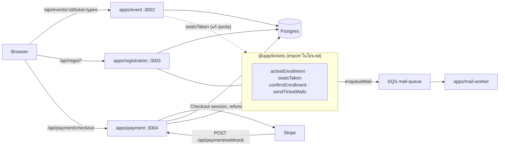
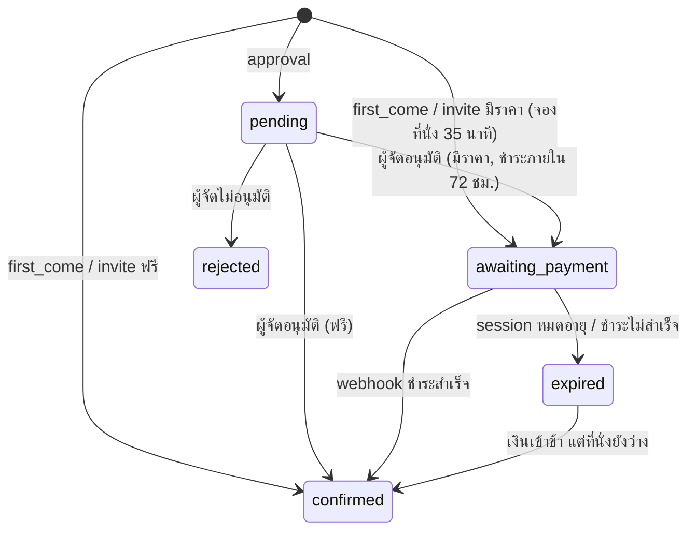
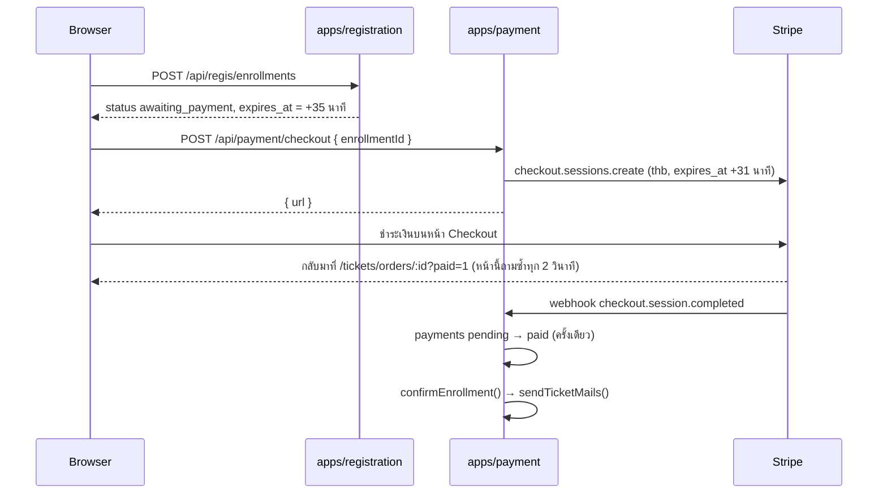

# ระบบตั๋ว (Tickets)

เอกสารนี้อธิบายว่า Eventide ขายและแจกตั๋วอย่างไร ตั้งแต่ผู้จัดสร้างประเภทตั๋วและแบบฟอร์ม จนถึงผู้ซื้อลงทะเบียน ชำระเงิน และผู้เข้าร่วมเห็นตั๋วในบัญชี

- **สาม service แบ่งกันถือข้อมูล:** `apps/event` ถือประเภทตั๋วและแบบฟอร์ม, `apps/registration` ถือการลงทะเบียนและตั๋ว, `apps/payment` ถือการชำระเงินผ่าน Stripe
- **`@app/tickets` เป็น library ไม่ใช่ service:** โค้ดที่ registration และ payment ต้องใช้ร่วมกัน (นับที่นั่ง, ยืนยันการลงทะเบียน, ส่งอีเมลตั๋ว) อยู่ที่นี่ ทุก service ใช้ DB เดียวกัน
- **ตั๋ว 1 ใบ = ผู้เข้าร่วม 1 คน:** ผู้ซื้อกรอกชื่อ นามสกุล อีเมล และคำตอบให้ผู้เข้าร่วมทีละคน ตั๋วส่งไปที่อีเมลนั้น และแสดงในบัญชีที่ใช้อีเมลนั้นด้วย

## สารบัญ

1. [ภาพรวม](#1-ภาพรวม)
2. [ประเภทตั๋ว](#2-ประเภทตั๋ว)
3. [แบบฟอร์มลงทะเบียน](#3-แบบฟอร์มลงทะเบียน)
4. [วงจรของการลงทะเบียน](#4-วงจรของการลงทะเบียน)
5. [ที่นั่งและการล็อก](#5-ที่นั่งและการล็อก)
6. [การชำระเงิน](#6-การชำระเงิน)
7. [ตั๋วของฉัน](#7-ตั๋วของฉัน)
8. [Endpoint และสิทธิ์](#8-endpoint-และสิทธิ์)
9. [เมื่อมีส่วนใดล่ม และข้อจำกัดที่รู้อยู่](#9-เมื่อมีส่วนใดล่ม-และข้อจำกัดที่รู้อยู่)
10. [การทดสอบและการตั้งค่า](#10-การทดสอบและการตั้งค่า)
11. [ไฟล์ที่เกี่ยวข้อง](#11-ไฟล์ที่เกี่ยวข้อง)

---

## 1. ภาพรวม

| ตาราง | เจ้าของ | เก็บอะไร |
|---|---|---|
| `ticket_types` | apps/event | ประเภท (`kind`), ชื่อ, รายละเอียด, ราคา (บาท), `quota`, `max_per_user` |
| `ticket_type_questions` | apps/event | คำถามของแต่ละประเภท เรียงด้วย `position` |
| `enrollments` | apps/registration | การลงทะเบียน 1 ครั้ง: ผู้ซื้อ, จำนวน, ราคาต่อใบ ณ ตอนนั้น, สถานะ, `expires_at` |
| `tickets` | apps/registration | ผู้เข้าร่วม 1 คน: ชื่อ, อีเมล (ตัวเล็ก), `code` สำหรับ QR, `answers` |
| `payments` | apps/payment | Checkout session ของ Stripe ต่อการลงทะเบียน |

## 2. ประเภทตั๋ว

| `kind` | ชื่อในเว็บ | จำนวนตั๋ว | ใครลงทะเบียนได้ |
|---|---|---|---|
| `first_come` | มาก่อนได้ก่อน | ต้องกำหนด `quota` | ทุกคนที่เปิดอีเวนต์ได้ |
| `approval` | ต้องได้รับอนุมัติ | ไม่จำกัด | ทุกคนที่เปิดอีเวนต์ได้ แล้วผู้จัดอนุมัติทีละรายการ |
| `invite` | เฉพาะผู้ได้รับเชิญ | ไม่จำกัด (จำกัดด้วยรายชื่อเชิญ) | อีเมลใน `event_invitations` คำเชิญละ 1 การลงทะเบียน |

- **ราคา** เป็นจำนวนเต็มบาท 0 คือฟรี ตั๋วที่ขายต้องราคาอย่างน้อย ฿20 เพราะ Stripe ไม่รับยอดต่ำกว่าราว $0.50 หลังแปลงสกุล
- **`max_per_user`** (1–10) นับรวมทุกการลงทะเบียนที่ยัง active ของบัญชีเดียวกันในประเภทนั้น ลงทะเบียนหลายครั้งก็เลี่ยงไม่ได้
- **แก้ประเภทตั๋วหลังมีคนลงทะเบียน:** เปลี่ยน `kind` ไม่ได้ (`KIND_LOCKED`), ลด `quota` ให้ต่ำกว่าที่จองไปแล้วไม่ได้ (`QUOTA_BELOW_TAKEN`), ลบไม่ได้ (`TICKET_TYPE_IN_USE`) แก้ราคาได้ เพราะการลงทะเบียนเก็บราคาต่อใบของตัวเองไว้แล้ว
- อีเวนต์ที่มีการลงทะเบียนลบไม่ได้ (`EVENT_HAS_ENROLLMENTS`) และคำเชิญที่ผูกกับการลงทะเบียนลบหรือเปลี่ยนอีเมลไม่ได้ (`INVITATION_USED`) ทั้งหมดมาจาก foreign key แบบ `ON DELETE RESTRICT`

## 3. แบบฟอร์มลงทะเบียน

- **ช่องบังคับของระบบ:** ชื่อ นามสกุล อีเมล มีในตั๋วทุกใบ ไม่ได้เก็บเป็นคำถาม หน้าแก้ไขแสดงเป็นแถวที่ล็อกไว้
  - ตั๋วใบแรกเติมจาก `users.first_name` / `last_name` (Better Auth `additionalFields` แก้ได้ที่ `/profile` และดึงจาก Google ตอนสมัคร) ถ้าว่างจะแยกจาก `users.name` ผู้ซื้อแก้ได้เสมอ
- **คำถามของผู้จัด** แยกตามประเภทตั๋ว รูปแบบ: ข้อความสั้น (≤ 200 ตัวอักษร), ข้อความยาว (≤ 2,000), ตัวเลือก (เลือก 1 ข้อ 2–20 ตัวเลือกที่ไม่ซ้ำ) แต่ละข้อตั้ง "จำเป็นต้องตอบ" ได้ สูงสุด 30 ข้อ
- **บันทึกทั้งรายการ:** `PATCH /:id/ticket-types/:ticketTypeId` ที่มี `questions` จะแทนที่รายการเดิม ข้อที่ส่ง `id` เดิมมาจะถูกแก้ในที่เดิม ข้อที่หายไปถูกลบ ข้อใหม่ถูกเพิ่ม และลำดับตามตำแหน่งใน array
- **คำตอบเป็นสำเนา:** ตั๋วเก็บ `{ questionId, label, value }` ตอนลงทะเบียน แก้หรือลบคำถามภายหลังจึงไม่กระทบคำตอบที่มีอยู่
- **เรียงลำดับด้วยการลาก:** หน้าแก้ไขใช้ `@dnd-kit/react` ลากที่ไอคอนจับ (หรือโฟกัสไอคอนแล้วกด Space, ลูกศร, Space) ระหว่างลาก การ์ดอื่นยุบเหลือหัวข้อ เพราะการ์ดตัวเลือกสูงกว่าการ์ดข้อความมาก ถ้าไม่ยุบ ตัวชี้จะไปอยู่บนการ์ดอีกใบหลังสลับ แล้วสลับกลับทันที

## 4. วงจรของการลงทะเบียน

- **Active** (`activeEnrollment()`) = `confirmed`, `pending`, หรือ `awaiting_payment` ที่ `expires_at` ยังไม่ถึง การลงทะเบียน active เท่านั้นที่นับที่นั่ง นับ `max_per_user` และถือคำเชิญ
- **การจองที่หมดเวลา** หยุดนับทันทีโดยไม่ต้องมี job ตั้งเวลา สถานะในตารางยังเป็น `awaiting_payment` จนกว่า webhook `checkout.session.expired` จะมาเปลี่ยน ระหว่างนั้นทุก endpoint อ่านเป็น `expired` (`effectiveStatus()`)
- **ยืนยันแล้ว** (`confirmEnrollment()` / `markConfirmed()`) ตั้ง `confirmed_at`, ล้าง `expires_at` และตั้ง `used_at` ของคำเชิญ (ตั๋ว invite) จากนั้น `sendTicketMails()` ส่งอีเมลถึงผู้เข้าร่วมทุกคนพร้อมรหัสตั๋ว ลิงก์ไป `/tickets/:id` หรือหน้าสมัครสมาชิกถ้าอีเมลนั้นยังไม่มีบัญชี

## 5. ที่นั่งและการล็อก

ทุกขั้นที่ตรวจที่นั่งเทียบ `quota` จะล็อกแถว `ticket_types` ก่อน (`SELECT … FOR UPDATE`) จึงไม่มีสองคำขอที่ได้ที่นั่งสุดท้ายพร้อมกัน:

- **ลงทะเบียน** (`enroll()`): ล็อกประเภทตั๋ว → ตรวจ `max_per_user` → ตรวจที่นั่ง → (invite) ล็อกแถวคำเชิญและตรวจว่ายังไม่มีการลงทะเบียน active อื่นใช้อยู่ → บันทึกการลงทะเบียนและตั๋ว
- **แก้ quota / kind** (`updateTicketType()`): ล็อกแถวเดียวกันก่อนนับ
- **ยืนยันหลังจองหมดเวลา** (`confirmEnrollment()`): ล็อกการลงทะเบียนและประเภทตั๋ว แล้วนับที่นั่งใหม่โดยไม่รวมตัวเอง ถ้าไม่พอคืน `SoldOut`

`test/enrollment.test.ts` ยิงลงทะเบียน 6 คำขอพร้อมกันกับ quota 3 และคาดว่าสำเร็จพอดี 3

## 6. การชำระเงิน

- **ไม่จ่ายซ้ำ:** checkout ล็อกแถวการลงทะเบียน และถ้ามี session ที่ยังเปิดอยู่จะคืน URL เดิม
- **Webhook ซ้ำไม่มีผล:** การเปลี่ยน `payments.status` จาก `pending` เป็น `paid` เป็นเงื่อนไขใน `UPDATE … WHERE status = 'pending'` ใครได้แถวไปคนแรกเท่านั้นที่ทำต่อ ถ้าขั้นต่อไปพัง จะคืนสถานะเป็น `pending` แล้วโยน error ให้ Stripe ส่งใหม่
- **เงินเข้าหลังหมดเวลาจอง:** ถ้าที่นั่ง (หรือคำเชิญ) ถูกคนอื่นใช้ไปแล้ว จะคืนเงินเต็มจำนวน (`stripe.refunds.create` พร้อม idempotency key) ตั้ง `refunded` และส่งอีเมลแจ้งผู้ซื้อ ตั๋ว approval ไม่มีที่นั่งให้แย่ง จึงยืนยันได้เสมอ
- **Session หมดอายุ / ชำระไม่สำเร็จ:** first_come / invite ปล่อยที่นั่ง (`expired`), approval ยังรอชำระได้จนถึงกำหนด 72 ชม. และเริ่ม session ใหม่ได้
- ช่องทางที่เงินเข้าช้า (เช่น โอนผ่านธนาคาร) จะได้ `completed` แบบ `unpaid` ก่อน ระบบรอ `async_payment_succeeded`

## 7. ตั๋วของฉัน

- `GET /api/regis/tickets/mine` คืน `orders` (การลงทะเบียนของผู้ซื้อที่รออนุมัติหรือรอชำระ) และ `tickets` (ตั๋วที่ยืนยันแล้ว ที่บัญชีนี้ **ซื้อ** หรือที่มี **อีเมลของบัญชีนี้**)
- ตั๋วที่คนอื่นซื้อให้แสดง "ซื้อโดย …" ผู้ซื้อเห็นตั๋วทุกใบในการลงทะเบียนของตน
- `GET /api/regis/tickets/:id` ตอบเฉพาะผู้ซื้อและเจ้าของอีเมล คนอื่นได้ 404 รหัสตั๋วแสดงเมื่อยืนยันแล้วเท่านั้น

## 8. Endpoint และสิทธิ์

| Endpoint | สิทธิ์ |
|---|---|
| `GET /api/events/:id/ticket-types` | ใครก็ได้ที่เปิดอีเวนต์ได้ (กฎเดียวกับ `GET /api/events/:id`) |
| `POST/PATCH/DELETE /api/events/:id/ticket-types[/:ticketTypeId]` | ผู้จัดของอีเวนต์หรือ admin (`eventOwner`) อีเวนต์ที่ถูกระงับแก้ไม่ได้ |
| `GET /api/regis/events/:eventId/availability` | ใครก็ได้ที่เปิดอีเวนต์ได้ บอกที่นั่งและ `state` ของผู้ถาม |
| `POST /api/regis/enrollments` | ผู้ใช้ที่เข้าสู่ระบบ |
| `GET /api/regis/enrollments/:id` | ผู้ซื้อ, ผู้จัด, admin |
| `GET /api/regis/events/:eventId/enrollments` | ผู้จัดหรือ admin (`eventOwner`) |
| `POST /api/regis/enrollments/:id/approve`, `/reject` | ผู้จัดหรือ admin (`enrollmentManager`) |
| `GET /api/regis/tickets/mine`, `/tickets/:id` | ผู้ใช้ที่เข้าสู่ระบบ (เฉพาะของตัวเอง) |
| `POST /api/payment/checkout` | ผู้ซื้อของการลงทะเบียนนั้น |
| `POST /api/payment/webhook` | Stripe (ตรวจลายเซ็นด้วย `STRIPE_WEBHOOK_SECRET`) |

การลงทะเบียนเปิดเมื่ออีเวนต์เป็น `public` ที่เผยแพร่แล้ว หรือ `invite` และผู้ถามได้รับเชิญ และอีเวนต์ยังไม่จบ ผู้จัดเห็นอีเวนต์ฉบับร่างของตัวเองได้ แต่สถานะตั๋วเป็น `closed` (`eventAccess()` ใน `apps/registration/src/libs/access.ts` ต้องตรงกับ `findVisibleEvent()` ของ apps/event)

## 9. เมื่อมีส่วนใดล่ม และข้อจำกัดที่รู้อยู่

- **คิวอีเมลล่ม:** การลงทะเบียนและการยืนยันยังสำเร็จ `sendTicketMails()` ไม่โยน error แค่ log ไว้ ผู้เข้าร่วมยังเห็นตั๋วในเว็บ
- **Stripe ล่มตอนสร้าง session:** `PAYMENT_UNAVAILABLE` (503) ที่นั่งยังถูกจองไว้ ผู้ซื้อกดชำระใหม่ได้จากหน้ารายการก่อนหมดเวลา
- **Webhook มาช้า:** หน้า `/tickets/orders/:id?paid=1` ถามซ้ำ 30 วินาที แล้วบอกว่ายังไม่ได้รับการยืนยัน และไม่ต้องชำระซ้ำ
- **ไม่ได้ตั้ง `STRIPE_WEBHOOK_SECRET`:** ทุก event ถูกปฏิเสธ (400) การลงทะเบียนแบบมีราคาจะค้างที่ `awaiting_payment` จนหมดเวลา
- **การยืนยันอีเมล:** ระบบยังไม่ได้ยืนยันอีเมลตอนสมัคร ใครสมัครด้วยอีเมลใดก่อนจะเห็นตั๋วของอีเมลนั้น ข้อจำกัดเดียวกับคำเชิญ
- **ยังไม่มี:** การยกเลิก/ขอคืนเงินโดยผู้ซื้อ และการเช็กอินด้วย QR (`tickets.code` เตรียมไว้แล้ว)

## 10. การทดสอบและการตั้งค่า

- `apps/event/test/ticket-type.test.ts`: กฎของ kind / quota / ราคา, การแทนที่และเรียงคำถาม, สิทธิ์, การล็อกเมื่อมีผู้ลงทะเบียน
- `apps/registration/test/enrollment.test.ts`: ลงทะเบียนพร้อมกันไม่เกิน quota, `max_per_user`, คำเชิญ, อนุมัติ/ไม่อนุมัติ, ตรวจคำตอบ, ตั๋วของฉัน
- `apps/payment/test/checkout.test.ts`: mock `src/libs/stripe` แต่เซ็น webhook จริงด้วย `generateTestHeaderStringAsync` ครอบคลุม session ซ้ำ, ลายเซ็นผิด, webhook ซ้ำ, หมดอายุ, และคืนเงินเมื่อเงินเข้าช้า
- รันด้วย `bun run test` ในแต่ละ workspace (ต้อง `bun run infra:up`)
- Dev: ตั้งค่า Stripe ตาม [docs/stripe.md](stripe.md) (สร้าง sandbox, restricted key, `bun run stripe:listen`, บัตรทดสอบ, การแก้ปัญหา)

## 11. ไฟล์ที่เกี่ยวข้อง

| ไฟล์ | หน้าที่ |
|---|---|
| `packages/db/src/schema/event.ts` | `ticket_types`, `ticket_type_questions` |
| `packages/db/src/schema/registration.ts` | `enrollments`, `tickets`, `payments` |
| `packages/tickets/src/` | `activeEnrollment`, `seatsTaken`, `confirmEnrollment`, `sendTicketMails`, `ticketCode` |
| `apps/event/src/routes/ticket-types/` | CRUD ประเภทตั๋วและคำถาม |
| `apps/registration/src/routes/{availability,enrollments,tickets}/` | ที่นั่ง, ลงทะเบียน, อนุมัติ, ตั๋วของฉัน |
| `apps/registration/src/plugins/event-owner.ts` | `eventOwner` และ `enrollmentManager` |
| `apps/payment/src/routes/{checkout,webhook}/` | Stripe Checkout และ webhook |
| `apps/web/src/routes/_authed/dashboard/events/$eventId/tickets/` | หน้าประเภทตั๋วและตัวแก้ไขแบบฟอร์ม |
| `apps/web/src/routes/_authed/dashboard/events/$eventId/participants.tsx` | รายชื่อผู้ลงทะเบียนและการอนุมัติ |
| `apps/web/src/routes/_authed/events/$slug/enroll/$ticketTypeId.tsx` | หน้าลงทะเบียน |
| `apps/web/src/routes/_authed/tickets/` | ตั๋วของฉัน, ตั๋วพร้อม QR, สถานะการลงทะเบียน |
